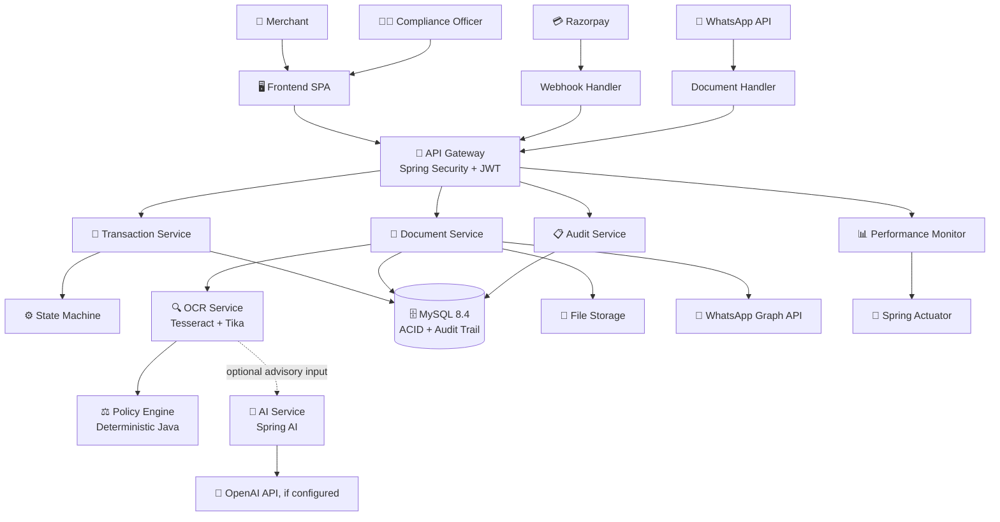
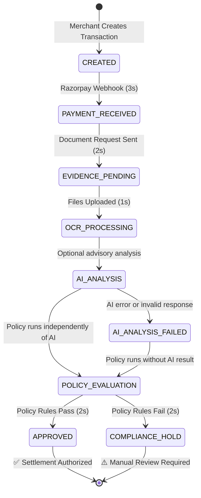

# 🛡️ Aegis-X: AI-Powered Fintech Compliance Orchestration

> **Intelligent Compliance Automation for Modern Financial Institutions**

Aegis-X implements fintech compliance workflows with advisory AI and deterministic policy enforcement. Built with **Java 21 + Spring Boot 3**, it records the decisions and audit events covered by the verification suite.

## 🚀 Live Demo & Resources

| Resource | Link | Description |
|----------|------|-------------|
| **🌐 Demo Link** | [aegis-x-demo.netlify.app](https://aegis-x-demo.netlify.app) | Availability and external integrations are not verified |
| **📡 API Backend** | [aegis-x-api.railway.app](https://aegis-x-api.railway.app) | Listed deployment endpoint; availability is not verified |
| **📊 API Docs** | [/swagger-ui.html](https://aegis-x-api.railway.app/swagger-ui.html) | Listed API documentation endpoint; availability is not verified |
| **💻 Source Code** | [GitHub Repository](https://github.com/Aakash02A/Aegis-X) | Complete codebase with documentation |
| **🎥 Demo Script** | [Guided walkthrough](./DEMO_SCRIPT.md) | Local walkthrough notes |

## ⚡ Key Features & Demo Highlights

### 🤖 **AI-Powered Document Analysis** 
- **OCR Text Extraction**: Tesseract + Apache Tika for multi-format support
- **Optional AI Advice**: Structured findings, missing-evidence notes, and suggested checks; model output cannot set a payment decision
- **Untrusted Document Text**: OCR content is passed as data, parsed into a fixed response schema, and unknown fields such as `decision` are discarded
- **Confidence Labels**: Pattern-based extraction scores are labeled `HEURISTIC`; they are not calibrated probabilities or policy gates

### 🔄 **Processing Pipeline**
```
Payment → Evidence → OCR structured fields → Deterministic policy → Decision
                         └── optional AI advice (not a policy input)
```

### 📊 **Deterministic Policy Engine**
- **Java Rules Authority**: Final compliance decisions made by deterministic logic
- **AI Advisory Role**: Optional model findings are kept outside the deterministic rule context
- **Five Current Rules**: Document completeness, beneficiary match, exact amount consistency, currency consistency, and purpose-code whitelist
- **Decision Inputs**: Transaction fields, required-document checklist, and selected OCR structured fields; no AI value or OCR confidence score
- **Verdicts**: All five rules passing gives `APPROVED`; any failing rule gives `COMPLIANCE_HOLD`
- **Complete Explainability**: Every decision traced and auditable

### 🛡️ **Implemented Security Controls**
- JWT Authentication with RBAC (Role-Based Access Control)
- HMAC webhook signature validation
- SQL injection prevention + XSS protection
- Security headers (CSP, HSTS, X-Frame-Options)

### 🏆 **Local Workflow**
The documented workflow can run with the simulated provider and local storage:

1. **Merchant Registration** → Create an account and transaction
2. **Payment Event** → Simulated or configured Test Mode provider
3. **Evidence Upload** → Upload and extract document fields
4. **Optional AI Advice** → Structured findings; output does not determine the verdict
5. **Policy Evaluation** → Deterministic Java rules evaluate verified transaction, checklist, and OCR fields
6. **Dashboard and Audit** → Review current records and covered audit events

---
| **Audit Compliance** | Manual logs | 100% automated | **Complete traceability** |

---

## 🏗️ System Architecture



### **Core Architectural Principles**

> **🤖 AI Advises, Java Decides**
> - **AI Layer**: Optional advisory findings; OCR text is untrusted and model output cannot set a decision
> - **Policy Engine**: Uses five fixed rules; AI output and OCR confidence are not decision inputs
> - **Audit Events**: Policy and review decisions record actor, outcome, and supporting context

### **Technology Stack**
- **Backend**: Java 21 + Spring Boot 3.3.4 + Spring Security 6
- **Frontend**: Vanilla JavaScript + Vite 6 + Tailwind CSS 3
- **Database**: MySQL 8.4 with Flyway migrations (`db/migration`)  
- **AI Integration**: Spring AI with an optional configured OpenAI model
- **Security**: JWT + RBAC + CORS + CSRF protection
- **Deployment**: Railway (backend) + Netlify (frontend)
- **Processing**: Apache Tika + Tesseract OCR

---

## 🎯 Demo Link

The [demo frontend](https://aegis-x-demo.netlify.app) is listed here for reference; its availability and behavior have not been verified. Live Razorpay, WhatsApp, and OpenAI calls have not been verified.

---

## 🚀 Quick Start

### 🐳 **Option 1: Docker Compose (Recommended)**
```bash
# 1. Start Docker Desktop, then from the repository root:
cp .env.example .env

# 2. Set at least JWT_SECRET in .env. Database defaults are filled in by compose;
#    OpenAI/Razorpay/WhatsApp are optional and degrade gracefully when empty.

# 3. Start MySQL 8.4 + the backend (MySQL is published on 127.0.0.1:3307)
docker compose up --build -d

# 4. Start the frontend (it is not a compose service)
cd frontend && npm ci && npm run dev

# 5. Open:
#    Frontend:  http://127.0.0.1:3000
#    Backend:   http://localhost:8080
#    Health:    http://localhost:8080/actuator/health
```

On Windows, `run-aegis-x.bat` does all of the above: it creates `.env` from the template, starts
compose, launches Vite and opens the browser.

To stop: `docker compose down` (add `-v` to discard the database volume).

### ☁️ **Option 2: Cloud Deployment**
- **Backend**: Deploy to [Railway](./RAILWAY_DEPLOY.md) (managed MySQL included)
- **Frontend**: Deploy to [Netlify](./NETLIFY_DEPLOY.md) (global CDN distribution)
- **Database**: Railway MySQL (automatic provisioning)

### 🛠️ **Option 3: Local Development (no Docker)**

Requires JDK 21, Node 18+, and a running MySQL 8.4 server.

```bash
# 1. Create the database and a dedicated account (MySQL 8.4 on 3306)
mysql -u root -p -e "CREATE DATABASE aegisx CHARACTER SET utf8mb4 COLLATE utf8mb4_0900_ai_ci; \
  CREATE USER 'aegisx'@'localhost' IDENTIFIED BY 'change-me'; \
  GRANT ALL PRIVILEGES ON aegisx.* TO 'aegisx'@'localhost';"

# 2. Point .env at it. The URL parameters are required, not cosmetic.
#    DB_URL=jdbc:mysql://localhost:3306/aegisx?connectionTimeZone=UTC&forceConnectionTimeZoneToSession=true&characterEncoding=UTF-8&useSSL=false&allowPublicKeyRetrieval=true
#    DB_USERNAME=aegisx
#    DB_PASSWORD=change-me

# 3. Export .env into the process (Spring Boot does not read .env itself).
#    Do NOT use `. ./.env`. Two things break it: the `&` in DB_URL is a shell operator that
#    leaves DB_URL empty, and a Windows-edited .env has CRLF endings, so every value would end
#    in a stray carriage return. Reading line by line and trimming the CR avoids both.
while IFS= read -r line || [ -n "$line" ]; do
  line="${line%$'\r'}"
  case "$line" in ''|'#'*) continue ;; esac
  export "$line"
done < .env
export PORT=8080        # 8080 is the default; set this only to run somewhere else

# 4. Run the backend; Flyway creates the schema from empty
cd backend && ./mvnw spring-boot:run

# 5. In a second terminal, run the frontend
cd frontend && npm ci && npm run dev

# 6. Open http://127.0.0.1:3000, register a merchant account, then sign in.
#    Health check: http://localhost:8080/actuator/health (expect "database":"MySQL", status UP)
```

Startup time depends on the local Maven cache and machine. Stop each process with `Ctrl+C`.

If the backend dies with `ClassFormatError: Invalid method Code length 0 in class file …` (or any
other class-file error), `target/classes` is stale — most often left behind by an interrupted
build. Run `./mvnw clean` once, then start again.

### XAMPP MariaDB

XAMPP's bundled server is MariaDB, not MySQL 8.4. To run the project against XAMPP without
touching the existing `aegisx` database, use a separate development schema and the `xampp`
profile:

```powershell
$env:DB_URL='jdbc:mysql://localhost:3306/aegisx_xampp?createDatabaseIfNotExist=true&connectionTimeZone=UTC&forceConnectionTimeZoneToSession=true&characterEncoding=UTF-8&useSSL=false&allowPublicKeyRetrieval=true'
$env:DB_USERNAME='root'
$env:DB_PASSWORD='your-xampp-password'
$env:SPRING_PROFILES_ACTIVE='xampp'
cd backend
mvn spring-boot:run
```

The XAMPP profile disables the MySQL-8.4 Flyway migrations and uses Hibernate's development
schema generation. Use the Docker Compose path or a MySQL 8.4 server when migration fidelity and
production-like validation are required.

---

## 📊 State Machine & Processing Pipeline

### **Transaction State Flow**


### **Performance Verification**
No load test or end-to-end latency benchmark was run for this verification. No response-time or throughput claim is made.

---

## 🔐 Security & Compliance

The application implements JWT authentication, role checks, webhook signature validation, upload limits, and security headers. These are implementation notes, not an independent security assessment or grade. Production configuration rejects missing or weak JWT secrets and empty CORS origins.

### **Audit and Operations Notes**
- Policy decisions and manual review decisions produce audit events covered by tests.
- Audit APIs reject write attempts; database-level or cryptographic tamper resistance is not claimed.
- OpenAI is optional. A live model call has not been verified; configured calls may send document-derived text to the provider.
- The in-memory rate limiter is single-instance only; each additional process has its own allowance.

---

## 🔧 Development & Testing

### **Automated Validation Framework**
Verification commands and evidence are recorded in `docs/HANDOFF.md`.

```bash
# Backend unit and integration suite
cd backend
./mvnw test
cd ..

# MySQL-backed HTTP end-to-end flow (uses local aegisx_audit)
bash tests/e2e/run-e2e.sh
```

### **Verification Scope**
- Backend tests cover policy, persistence, authorization, audit, and simulated-provider behavior.
- Live Razorpay, WhatsApp, and OpenAI services are **NOT VERIFIED**.
- Load and latency benchmarks are **NOT VERIFIED**.

### **Development Setup**
```bash
# Backend development
cd backend
./mvnw spring-boot:run

# Frontend development (with hot reload)
cd frontend  
python -m http.server 3000

# Database setup
docker compose up -d mysql

# Run tests
./mvnw clean test
```

### **Build & Package**
```bash
# Production build
./mvnw clean package

# Docker image build
docker build -t aegis-x-backend ./backend

# Multi-platform build  
docker buildx build --platform linux/amd64,linux/arm64 -t aegis-x .
```

---

## 🧾 Payment Integrity, Reconciliation & Exception Recovery Engine

The `com.aegisx.integrity` bounded context is Aegis-X's payment-operations layer. It monitors payment
lifecycle events, keeps a canonical transaction history, reconciles provider records against internal
order and transfer records, explains inconsistencies, and recommends safe next actions.

**It collects evidence, provides optional AI advice, records Java-decided policy outcomes, and
reconciles provider data.** Aegis-X has no customer payment capture or refund path; those actions
occur at the external provider and their results are observed here. The separate RazorpayX payout
adapter can submit Test Mode payouts only. It is disabled by default and requires an approved
settlement and an authorized API role. Live funds movement is outside the supported product scope.

**The central invariant:** the system always distinguishes a **provider-confirmed financial outcome**
from an **internal hypothesis** about that outcome. Webhook observations, API-confirmed state,
internal records, inferred values and simulated values each carry an explicit evidence rank, and the
simulated flag travels into observations, findings, the dashboard and the audit trail, so a simulated
outcome can never be mistaken for a provider-confirmed one.

### What it does

* **Duplicate-safe webhook ingestion** — HMAC-SHA256 verification over the exact raw body, then
deduplication on the provider event id enforced by a **database unique constraint**. A repeat delivery
is acknowledged and produces no business effect; a concurrent delivery that loses the insert race is
treated as a duplicate.
* **A canonical lifecycle state machine** — a terminal state is never reverted by a later event,
however late it arrives. The single exception is a live **provider API** lookup reporting `CAPTURED`
after a recorded `FAILED`, which wins and is still flagged as a conflict. An internal timeout becomes
`TIMEOUT_UNKNOWN`, never `FAILED`.
* **Reconciliation with an evidence hierarchy** — provider API state outranks webhooks, which outrank
internal records, which outrank inferred values.
* **Explainable exception classification** — each case states why it exists, the evidence it rests on,
what is still unknown, and a recommended next action.
* **Human-gated recovery recommendations** — actions are recorded for review; the integrity recovery
endpoint is read-only and does not dispatch provider mutations.
* **An append-only audit trail** and an operations dashboard whose every figure is a database read.

### Documentation

| Document | Contents |
|---|---|
| [Literature and competitor survey](doc/integrity/01_Literature_and_Competitor_Survey.md) | Source-checked survey, what is verified, what is not, comparison matrices |
| [Requirements and research design](doc/integrity/02_Requirements_and_Research_Design.md) | Product spec, requirements, revised research question, baselines |
| [Architecture, lifecycle and data model](doc/integrity/03_Architecture_State_and_Data_Model.md) | Architecture diagram, state diagram, ER diagram, workflow |
| [API specification](doc/integrity/04_API_Specification.md) | Every integrity endpoint |
| [Research report](doc/integrity/05_Research_Report.md) | Methodology, measured results, limitations |
| [Benchmark results](doc/integrity/benchmark-results/integrity-benchmark-results.md) | The raw output of the reported run |

### Running it

```bash
# 1. Database (the MySQL migrations create every table, including the pi_* integrity tables)
docker compose up -d mysql

# 2. Backend
cd backend && ./mvnw spring-boot:run

# 3. Frontend (serves the integrity console on http://127.0.0.1:3000/integrity.html)
cd frontend && npm install && npm run dev
```

Open `http://127.0.0.1:3000/integrity.html`, sign in, then use **Integration Settings** to check
provider connectivity and **Transactions** to create an order and simulate its payment. Inject a
controlled fault from the same screen and re-run reconciliation to watch an exception case appear,
be investigated, be resolved, and be verified or reopened by the next run.

Environment variables are documented in [`.env.example`](.env.example) and are read from the
environment only. No Razorpay secret is ever embedded in front-end JavaScript or committed.
`INTEGRITY_ALLOW_FINANCIAL_EXECUTION` defaults to `false` and should stay `false`.

### Tests

```bash
cd backend
./mvnw test                                            # the whole suite (H2)
./mvnw -Dtest='PaymentLifecycleStateMachineTest,ProposedMethodTest' test
./mvnw -Dtest='IntegrityWebhookIngestionTest,IntegrityReconciliationWorkflowTest,IntegrityRecoverySafetyTest' test
./mvnw -Dtest='IntegrityApiContractTest' test           # the exact paths the console calls
./mvnw -Dtest='IntegrityBenchmarkTest' test            # writes target/benchmark-results/
```

### Database: MySQL 8.4

MySQL 8.4 is the only supported database. The `dev`, `prod` and `test` profiles all point at it, and
Flyway migrates it from `db/migration`; the consolidated baseline plus `V28` represent the whole
schema. Hibernate starts with `ddl-auto=validate` in `dev` and `prod`, so a disagreement between the
entity model and the migrations fails startup instead of being silently auto-corrected.

```bash
# Database only, on 127.0.0.1:3307. Port 3306 is deliberately left to a MySQL you already run.
docker compose up -d mysql

# Backend against it, from the host
export SPRING_PROFILES_ACTIVE=dev
export DB_URL='jdbc:mysql://localhost:3307/aegisx?connectionTimeZone=UTC&forceConnectionTimeZoneToSession=true&characterEncoding=UTF-8&useSSL=false&allowPublicKeyRetrieval=true'
export DB_USERNAME=root DB_PASSWORD=
./mvnw spring-boot:run
```

Or the whole stack in containers (backend and database):

```bash
JWT_SECRET=<a-secret> docker compose up -d app
```

The MySQL verification suite is opt-in, so a plain `mvn test` still runs on H2 and every `MySql*Test`
is skipped:

```bash
# Flyway migrates a THROWAWAY schema from empty and Hibernate validates against the result.
export INTEGRITY_MYSQL_URL='jdbc:mysql://localhost:3307/aegisx_mysqlverify?connectionTimeZone=UTC&forceConnectionTimeZoneToSession=true&useSSL=false&allowPublicKeyRetrieval=true'
export INTEGRITY_MYSQL_USER=root INTEGRITY_MYSQL_PASS=
./mvnw test -Dtest='MySql*Test'
```

[docs/POSTGRESQL_TO_MYSQL_MIGRATION.md](docs/POSTGRESQL_TO_MYSQL_MIGRATION.md) records the type
mapping, the engine differences that are deliberate, and the measured evidence.

### Benchmark headline

Deterministic, seed `20261010`, 216 scenarios (18 fault kinds × 12: 10 payment-lifecycle and 8
evidence), all three methods receiving identical evidence. The evidence checks are measured on the
same scenarios' paperwork view, so the evidence layer is scored rather than asserted:

| Method | Precision | Recall | F1 | Unreported | Unsafe automatic actions |
|---|---:|---:|---:|---:|---:|
| Baseline 1 — direct status/amount comparison | 0.6667 | 0.3333 | 0.4444 | 72 | 0 |
| Baseline 2 — rules engine with dedup and a basic state model | 1.0000 | 0.6111 | 0.7586 | 42 | 0 |
| Proposed — evidence-based classification | 1.0000 | 1.0000 | 1.0000 | 0 | 0 |
| Deterministic evidence checks (cross-record, document side) | 1.0000 | 1.0000 | 1.0000 | 0 | 0 |

An evidence scenario's payment side is a clean pack on purpose: it doubles as a false-positive
probe for the three reconciliation methods, whose recall is not diluted by evidence findings they
cannot produce.

### Limits of sandbox testing — read this before quoting any number

* **Synthetic data only.** The results say nothing about real-world payment accuracy or fraud
  prevention.
* **Circularity.** The scenario generator, the oracle sets and the method share one author. A perfect
  F1 is an artefact of that, and is evidence of **regression safety and internal consistency**, not of
  general accuracy.
* **The benchmark can only measure faults it was told to inject.** A fixture defect found during
  development declared a fault it never actually created; the harness now covers it, but the class of
  error remains.
* **Investigation effort is a documented proxy**, not measured human time.
* **No live provider round trip** is part of the benchmark, and Route transfers are asserted to be
  enabled rather than discovered, because that is an account-level product that cannot be probed
  reliably.
* **Benchmark scenarios are synthetic test fixtures**, not live provider results. The production
  simulator has been removed; Razorpay Test Mode is the only configured runtime provider.

## 📖 Project Structure & Documentation

### **Backend Architecture** (`backend/src/main/java/com/aegisx/`)
```text
├── 🔐 auth/                 # JWT authentication & user management
├── 💳 payment/              # Razorpay webhook handling & validation  
├── 💼 transaction/          # Core transaction lifecycle & state machine
├── 📄 document/             # File upload, OCR processing, evidence management
├── 🧠 ai/                   # Spring AI integration & OpenAI analysis
├── ⚖️ policy/               # Deterministic Java compliance rule engine
├── 👨‍💼 compliance/           # Manual compliance review & officer workflow
├── 📋 audit/                # Audit events and event logging
├── 🔗 integration/          # External service gateways (Razorpay, WhatsApp)
├── 📱 notification/         # WhatsApp messaging & alert dispatching
├── 📊 performance/          # Monitoring, metrics, and performance tracking
├── 🛡️ security/             # Security configuration & header management
├── 🏥 controller/           # REST API controllers & health endpoints
└── 🔧 common/               # Shared utilities, config, DTOs, exceptions
    ├── config/              # Security, CORS, database configuration
    ├── dto/                 # API request/response objects
    ├── exception/           # Custom exceptions & global error handling
    └── util/                # Helper utilities & validation
```

### **Frontend Structure** (`frontend/`)
```text  
├── 📱 index.html            # Main SPA entry point
├── 📄 pages/                # Individual page templates
│   ├── login.html           # Authentication interface
│   ├── dashboard.html       # Merchant transaction dashboard  
│   ├── operations.html      # Compliance officer operations
│   └── transaction.html     # Transaction detail & audit view
├── 🎨 css/                  # Styling & responsive design
│   └── style.css            # Bootstrap customization & animations
├── ⚙️ js/                   # Application logic & API integration
│   ├── app.js              # Main application controller
│   ├── api.js              # REST API client & authentication
│   ├── dashboard.js        # Transaction management interface  
│   ├── operations.js       # Compliance operations dashboard
│   ├── real-time-updates.js # WebSocket-like real-time updates
│   └── transaction-detail.js # Transaction timeline & audit display
└── 📂 assets/               # Images, documents, sample files
```

### **Documentation & Demo Materials**
```text
├── 📋 README.md                        # This comprehensive guide
├── 🏗️ ARCHITECTURE_DIAGRAM.md         # Detailed system architecture  
├── 🎯 DEMO_SCRIPT.md                   # Local walkthrough script
├── ✅ DEMO_PREPARATION_CHECKLIST.md    # Pre-demo validation checklist
├── 🎨 AEGIS_X_PITCH_DECK.md           # Hackathon presentation slides
├── 📝 PRESENTATION_NOTES.md           # Speaking notes & Q&A prep
├── 🔍 DEMO_VALIDATION_CHECKLIST.md    # Complete workflow validation
├── 🔗 INTEGRATION_VERIFICATION.md     # External API integration status
├── ⚡ PERFORMANCE_VALIDATION.md       # Response time & load testing
├── 🛡️ SECURITY_VERIFICATION_CHECKLIST.md # Security controls assessment
├── 📊 INTEGRATION_SUMMARY.md          # Integration test results
├── 🚂 RAILWAY_DEPLOY.md               # Backend deployment guide
├── 🌐 NETLIFY_DEPLOY.md               # Frontend deployment guide  
└── 🔧 .env.example                    # Environment configuration template
```

---

## 🎯 API Documentation & Usage

### **Interactive API Documentation**
👉 **[Swagger UI](https://aegis-x-api.railway.app/swagger-ui.html)** - Full API documentation with test interface

### **Key API Endpoints**

#### **🔐 Authentication**
```bash
# Register new user
POST /api/auth/register
{
  "fullName": "Demo Merchant Ltd",
  "email": "merchant@example.com", 
  "password": "SecurePass123!",
  "role": "MERCHANT"
}

# Login
POST /api/auth/login  
{
  "email": "merchant@example.com",
  "password": "SecurePass123!"
}
# Returns: JWT token for authenticated requests

# Get current user profile
GET /api/auth/me
Authorization: Bearer <jwt-token>
```

#### **💼 Transaction Management**
```bash
# Create transaction
POST /api/transactions
Authorization: Bearer <jwt-token>
{
  "amount": 50000.00,
  "currency": "USD", 
  "beneficiaryName": "Pacific Coast Trading",
  "purposeCode": "P0103"
}

# List merchant transactions (paginated)
GET /api/transactions?page=0&size=10
Authorization: Bearer <jwt-token>

# Get transaction details with audit trail
GET /api/transactions/{transactionId}
Authorization: Bearer <jwt-token>
```

#### **📄 Document Management**
```bash
# Upload compliance documents
POST /api/documents/upload/{transactionId}
Authorization: Bearer <jwt-token>
Content-Type: multipart/form-data
files: [document1.pdf, document2.jpg]

# Get document processing status
GET /api/documents/{transactionId}/status
Authorization: Bearer <jwt-token>

# Download processed document results
GET /api/documents/{documentId}/download
Authorization: Bearer <jwt-token>
```

#### **📊 Operations Dashboard** (Compliance Officers)
```bash
# Get compliance statistics
GET /api/operations/statistics
Authorization: Bearer <compliance-officer-token>

# List transactions requiring review
GET /api/operations/review-queue
Authorization: Bearer <compliance-officer-token>

# Get system performance metrics  
GET /api/operations/performance
Authorization: Bearer <compliance-officer-token>
```

#### **💳 Webhook Endpoints** (External Integration)
```bash
# Razorpay payment webhook
POST /api/webhooks/razorpay
X-Razorpay-Signature: <hmac-sha256-signature>
X-Razorpay-Event-Id: <unique-event-id>

# WhatsApp document webhook  
POST /api/webhooks/whatsapp
X-Hub-Signature-256: <hmac-sha256-signature>
```

#### **🏥 Health & Monitoring**
```bash
# Application health
GET /api/health
# Returns: "Aegis-X Backend Running"

# Detailed health with dependencies
GET /actuator/health  
# Returns: {"status":"UP", "components":{...}}

# Performance metrics (Prometheus format)
GET /actuator/prometheus

# Application information
GET /actuator/info
```

---

## 🔧 Environment Configuration

Copy the sample environment variables:

```bash
cp .env.example .env
```

For how to obtain each credential (Razorpay Test Mode, Meta WhatsApp Cloud API, OpenAI), where each
variable must be placed for `docker compose` versus a local Maven run, and how to verify the app
picked it up, see **[docs/CREDENTIALS_SETUP.md](docs/CREDENTIALS_SETUP.md)**. For the backend-created
Razorpay checkout and RazorpayX India payout setup, see
**[docs/razorpay-production-setup.md](docs/razorpay-production-setup.md)**.

### **Required Environment Variables**

Copy and configure the environment template:
```bash
cp .env.example .env
# Edit .env with your actual values
```

### **Core Configuration**
```bash
# Database (MySQL 8.4)
DB_URL=jdbc:mysql://localhost:3306/aegisx?connectionTimeZone=UTC&forceConnectionTimeZoneToSession=true
DB_USERNAME=aegisx
DB_PASSWORD=your-secure-db-password

# JWT Security
JWT_SECRET=your-super-secure-jwt-secret-at-least-32-characters-long
JWT_EXPIRATION=86400000  # 24 hours in milliseconds

# CORS Security  
CORS_ALLOWED_ORIGINS=https://your-frontend-domain.com
```

### **External API Integration**
```bash
# OpenAI (Optional advisory analysis; not required for policy decisions)
OPENAI_API_KEY=your_openai_api_key_here

# Razorpay (Required for Payment Processing)
RAZORPAY_KEY_ID=rzp_test_your_key_id_here
RAZORPAY_KEY_SECRET=your_razorpay_key_secret_here
RAZORPAY_WEBHOOK_SECRET=your_razorpay_webhook_secret_here

# RazorpayX payout credentials; keep disabled until account and webhook setup are verified
RAZORPAYX_ENABLED=false
RAZORPAYX_KEY_ID=
RAZORPAYX_KEY_SECRET=
RAZORPAYX_ACCOUNT_NUMBER=
RAZORPAYX_PAYOUT_MODE=NEFT

# WhatsApp Business API (Required for Document Requests)
WHATSAPP_PHONE_NUMBER_ID=your_whatsapp_phone_number_id
WHATSAPP_ACCESS_TOKEN=your_whatsapp_access_token  
WHATSAPP_VERIFY_TOKEN=your_whatsapp_verify_token
WHATSAPP_APP_SECRET=your_whatsapp_app_secret
```

### **Optional Configuration**
```bash
# Storage (local disk only; an S3 adapter is not implemented)
STORAGE_TYPE=local
APP_STORAGE_ROOT_PATH=./storage

# OCR on scanned images (optional; text PDFs work without it)
TESSERACT_PATH=
OCR_LANGUAGE=eng

# Monitoring & Logging
SPRING_PROFILES_ACTIVE=prod
LOGGING_LEVEL_ROOT=INFO
MANAGEMENT_ENDPOINTS_WEB_EXPOSURE_INCLUDE=health,info,metrics,prometheus
```

Only the database and `JWT_SECRET` are needed to start. Everything else enables an integration; the
application degrades rather than failing when one is absent — see
[docs/CREDENTIALS_SETUP.md](docs/CREDENTIALS_SETUP.md).

| Variable | Needed to start | Description | Example |
|----------|-----------------|-------------|---------|
| `DB_URL` | ✅ | MySQL connection URL (parameters are required) | `jdbc:mysql://localhost:3306/aegisx?connectionTimeZone=UTC&forceConnectionTimeZoneToSession=true` |
| `DB_USERNAME` / `DB_PASSWORD` | ✅ | MySQL account | `aegisx` |
| `JWT_SECRET` | ✅ | HMAC signing key (32+ chars) | `your-super-secure-jwt-secret...` |
| `OPENAI_API_KEY` | — | Optional OpenAI API authentication for advisory findings | `your_openai_api_key` |
| `RAZORPAY_KEY_ID` / `RAZORPAY_KEY_SECRET` | — | Razorpay **Test Mode** keys | `rzp_test_abc123` |
| `RAZORPAY_WEBHOOK_SECRET` | — | Razorpay webhook signature verification | `your_webhook_secret` |
| `WHATSAPP_ACCESS_TOKEN` | — | WhatsApp Graph API token | `EAAx...` |
| `WHATSAPP_PHONE_NUMBER_ID` | — | Test number's numeric ID | `123456789012345` |
| `WHATSAPP_APP_SECRET` | — | Verifies inbound webhook signatures | `abc123...` |
| `WHATSAPP_VERIFY_TOKEN` | — | Completes Meta's webhook handshake | `your-verify-string` |
| `CORS_ALLOWED_ORIGINS` | — | Frontend origins for CORS (has a localhost default) | `https://yourapp.netlify.app` |

### **Environment Security Checklist**
- [ ] All secrets use environment variables (no hardcoded values)
- [ ] JWT secret is cryptographically secure (32+ characters)
- [ ] Database password changed from defaults
- [ ] CORS restricted to specific frontend domain only
- [ ] API keys have minimum required permissions
- [ ] Webhook secrets are unique and secure
- [ ] Production profile enabled (`SPRING_PROFILES_ACTIVE=prod`)

---

## 🚀 Production Deployment Guide

### **Deployment Options**

#### **🚂 Option 1: Railway + Netlify (Recommended)**
- **Backend**: [Railway Deploy Guide](./RAILWAY_DEPLOY.md) 
  - Managed MySQL database included
  - Automatic scaling and health checks
  - Built-in monitoring and logging
- **Frontend**: [Netlify Deploy Guide](./NETLIFY_DEPLOY.md)
  - Global CDN distribution
  - Automatic HTTPS certificates
  - Branch-based deployments

#### **🐳 Option 2: Docker Self-Hosted**
```bash
# Production Docker Compose setup
cp .env.example .env
# Configure production environment variables

# Deploy with production optimizations
docker compose -f docker-compose.prod.yml up -d

# Verify deployment
curl https://your-domain.com/actuator/health
```

#### **☁️ Option 3: Cloud Providers**
- **AWS**: ECS + RDS + CloudFront
- **Google Cloud**: Cloud Run + Cloud SQL + CDN
- **Azure**: Container Apps + Database + Front Door

### **Environment Configuration for Production**
```bash
# Security (Required)
JWT_SECRET=<cryptographically-secure-32+-character-key>
CORS_ALLOWED_ORIGINS=https://your-production-domain.com

# Database (Railway auto-provisions)
DATABASE_URL=<railway-mysql-url>

# External APIs (Required)
OPENAI_API_KEY=<your-production-openai-key>
RAZORPAY_KEY_ID=rzp_live_<your-live-key>
RAZORPAY_KEY_SECRET=<your-live-secret>
RAZORPAY_WEBHOOK_SECRET=<your-webhook-secret>

# WhatsApp Business API
WHATSAPP_ACCESS_TOKEN=<your-whatsapp-token>
WHATSAPP_PHONE_NUMBER_ID=<your-phone-number-id>
WHATSAPP_VERIFY_TOKEN=<your-verify-token>
WHATSAPP_APP_SECRET=<your-app-secret>

# Optional: File Storage
AWS_S3_BUCKET_NAME=<your-s3-bucket>
AWS_ACCESS_KEY_ID=<your-aws-key>
AWS_SECRET_ACCESS_KEY=<your-aws-secret>
```

### **Production Security Checklist** ✅
- [ ] All environment variables configured (no defaults)
- [ ] JWT secret is cryptographically secure (32+ characters)  
- [ ] CORS restricted to production frontend domain only
- [ ] Database credentials rotated from defaults
- [ ] All webhook secrets are unique and secure
- [ ] HTTPS enforced on all endpoints
- [ ] Rate limiting configured appropriately
- [ ] File upload restrictions enforced
- [ ] Security headers configured (CSP, HSTS, etc.)
- [ ] Monitoring and alerting configured

### **Post-Deployment Validation**
```bash
# Health checks
curl https://your-api-domain.com/actuator/health

# Complete workflow test
curl -X POST https://your-api-domain.com/api/auth/register \
  -H "Content-Type: application/json" \
  -d '{"fullName":"Test User","email":"test@example.com","password":"TestPass123!","role":"MERCHANT"}'

# Performance validation

# Security verification  
```

---

## 🚀 Windows Application Launcher


For Windows users, we provide a one-click launcher that handles the entire setup:

```batch
# Download and run the launcher
run-aegis-x.bat
```

The launcher starts MySQL 8.4 (published on `127.0.0.1:3307`) and the development-profile backend;
the backend reaches the database over the compose network. Nothing binds to 3306, so a MySQL server
you already run on that port is left alone.

**What the launcher does:**
1. ✅ Checks Docker installation and availability
2. ✅ Creates `.env` file from template (if missing)  
3. ✅ Stops any existing containers
4. ✅ Builds and starts all services (Database + Backend + Frontend)
5. ✅ Waits for services to be ready (health checks)
6. ✅ Opens frontend in browser automatically
7. ✅ Shows service URLs and local access instructions

**Launcher Features:**
- **Smart Environment Setup**: Automatically copies `.env.example` to `.env`
- **Health Monitoring**: Waits for backend to be ready before declaring success
- **User-Friendly Output**: Color-coded status messages and clear instructions
- **Local Access Instructions**: Shows setup guidance for the local stack
- **Log Monitoring**: Optional live log viewing with `docker compose logs -f`

**Manual Alternative** (if launcher doesn't work):
```bash
# 1. Setup environment
cp .env.example .env
# Edit .env with your API keys

# 2. Start services  
docker compose up --build -d

# 3. Check status
docker compose ps
curl http://localhost:8080/actuator/health

# 4. Open frontend
start frontend/index.html
```

---

## Verification History

No independent performance benchmark, external integration verification, or security grade is claimed here. Phase-specific evidence, commands, and limitations are recorded in [docs/HANDOFF.md](docs/HANDOFF.md).

---
## Project Summary

Aegis-X combines evidence handling, advisory AI, deterministic policy evaluation, and audit records. AI output does not make payment decisions.

Current verification results and unsupported modules are listed in [docs/HANDOFF.md](docs/HANDOFF.md). The repository does not claim production readiness.

---
## 📞 Contact & Links

### **🔗 Resources**
- **🌐 Live Demo**: [aegis-x-demo.netlify.app](https://aegis-x-demo.netlify.app)
- **📡 API Backend**: [aegis-x-api.railway.app](https://aegis-x-api.railway.app)  
- **💻 Source Code**: [GitHub Repository](https://github.com/Aakash02A/Aegis-X)
- **📚 API Documentation**: [Swagger UI](https://aegis-x-api.railway.app/swagger-ui.html)

### **📋 Documentation**
- **🎯 [Demo Script](./DEMO_SCRIPT.md)**: Local guided walkthrough
- **🏗️ [Architecture Guide](./ARCHITECTURE_DIAGRAM.md)**: Detailed system design
- **🎨 [Pitch Deck](./AEGIS_X_PITCH_DECK.md)**: Hackathon presentation
- **🔧 [Railway Deploy](./RAILWAY_DEPLOY.md)**: Backend deployment guide
- **🌐 [Netlify Deploy](./NETLIFY_DEPLOY.md)**: Frontend deployment guide

### **Demo Availability**

The external demo link is listed above; its availability and behavior have not been verified.

### **⚙️ Local Setup (One Command)**
```bash
# Windows: Run the launcher
run-aegis-x.bat

# Linux/Mac: Docker Compose  
docker compose up --build
```

---

**Built with ❤️ for the hackathon community**  
*Transforming fintech compliance, one transaction at a time.*
