# Aegis-X — Software Requirements Specification

> **Document ID:** AEGISX-SRS-001  
> **Version:** 2.0  
> **Date:** 2026-09-20  
> **Status:** Approved — Phase 01 Complete  
> **Classification:** Internal

---

## Table of Contents

1. [Introduction](#1-introduction)  
2. [Problem Statement](#2-problem-statement)  
3. [Business Scenario](#3-business-scenario)  
4. [User Personas](#4-user-personas)  
5. [Project Scope](#5-project-scope)  
6. [Transaction State Machine](#6-transaction-state-machine)  
7. [AI Responsibilities — Evidence Analysis Component](#7-ai-responsibilities--evidence-analysis-component)  
8. [Deterministic Policy Engine — Java Decision Authority](#8-deterministic-policy-engine--java-decision-authority)  
9. [Functional Requirements](#9-functional-requirements)  
10. [Non-Functional Requirements](#10-non-functional-requirements)  
11. [MVP Definition](#11-mvp-definition)  
12. [Success Metrics](#12-success-metrics)  
13. [Module Ownership](#13-module-ownership)  
14. [Requirements Traceability](#14-requirements-traceability)  
15. [Risk Register](#15-risk-register)  
16. [Architecture Guardrails](#16-architecture-guardrails)  
17. [Technology Stack](#17-technology-stack)  
18. [Glossary](#18-glossary)  
19. [Revision History](#19-revision-history)

---

## 1. Introduction

### 1.1 Purpose

This Software Requirements Specification (SRS) defines the functional and non-functional requirements for **Aegis-X**, an AI-assisted compliance and settlement orchestration system for cross-border payments. It serves as the authoritative reference for design, implementation, testing, and acceptance of all Aegis-X components.

### 1.2 Intended Audience

| Audience               | Usage                                                     |
|------------------------|-----------------------------------------------------------|
| Development Team       | Implementation guidance and technical constraints         |
| QA Engineers           | Test-case derivation and acceptance criteria              |
| Compliance Officers    | Validation that regulatory requirements are addressed     |
| Project Stakeholders   | Scope agreement and milestone tracking                    |
| System Architects      | Integration boundaries and technology decisions           |

### 1.3 Product Overview

Aegis-X is an intelligent compliance orchestration layer positioned between payment receipt and settlement in cross-border payment workflows. It automates evidence collection, leverages AI for document analysis, and enforces compliance decisions through a deterministic Java-based policy engine.

Instead of treating compliance as a single manual approval step, Aegis-X creates a **stateful evidence-driven workflow** where documents are collected, analyzed, validated, and audited before settlement proceeds.

### 1.4 Architectural Principle — AI as Advisor, Java as Authority

> [!IMPORTANT]
> **The foundational design constraint of Aegis-X is the strict separation between AI analysis and compliance decision-making.**
>
> - **AI** is an evidence-analysis component. It reads, extracts, interprets, and scores documents. It produces structured advisory output. It **never** makes compliance decisions, mutates transaction state, or triggers financial actions.
> - **Java** is the final decision-maker. The deterministic policy engine, written in Java, consumes AI output as one of several inputs, evaluates hard-coded compliance rules, and produces the authoritative APPROVED or HOLD verdict. Only Java code may transition a transaction's state or instruct a payment gateway to settle funds.
>
> This separation is not an implementation preference — it is a compliance requirement. No amount of AI confidence can bypass a failing deterministic rule.

### 1.5 Definitions and Conventions

- **SHALL** — Indicates a mandatory requirement.
- **SHOULD** — Indicates a recommended but non-mandatory requirement.
- **MAY** — Indicates an optional requirement.
- Requirements are tagged with unique identifiers (e.g., `FR-01`, `NFR-01`) for traceability.

---

## 2. Problem Statement

### 2.1 The Existing Problem

Cross-border payments are frequently delayed because compliance information is spread across multiple disconnected processes.

A typical payment may require:

- Commercial invoice
- Beneficiary verification
- Purpose-code validation
- Supporting documents
- Compliance review

Current workflows typically involve manual emails, repeated follow-ups, and fragmented tracking.

### 2.2 Existing Workflow

```text
Payment Created
      ↓
Manual Email to Merchant
      ↓
Invoice Requested
      ↓
Supporting Documents Requested
      ↓
Compliance Review (Manual)
      ↓
Payment Released (Eventually)
```

### 2.3 Root Causes

| # | Root Cause | Impact |
|---|-----------|--------|
| 1 | **Missing documents delay settlement.** | Authorized payments sit idle for days while compliance officers chase paperwork. |
| 2 | **Compliance teams manually chase customers.** | Officers spend the majority of their time requesting and re-requesting documents via email, phone, and messaging. |
| 3 | **No centralized transaction state.** | Payment state lives in the gateway, compliance evidence lives in email attachments, review notes live in spreadsheets. No single system holds the truth. |
| 4 | **Audit trails become fragmented.** | When regulators request transaction history, teams must reconstruct timelines from multiple sources. |
| 5 | **Traditional rule engines struggle when information is incomplete.** | Even with high-confidence AI analysis, financial regulations require deterministic, auditable, and explainable decision logic. |

### 2.4 Proposed Solution

**Aegis-X** introduces an **evidence-first compliance workflow** between payment receipt and settlement. It unifies evidence collection, document analysis, and compliance decisions into a single auditable pipeline.

```text
Payment Event
      ↓
Webhook
      ↓
Transaction Created
      ↓
Evidence Collection
      ↓
OCR Processing
      ↓
AI Analysis
      ↓
Deterministic Policy Engine
      ↓
APPROVED  →  Settlement
COMPLIANCE_HOLD  →  Human Review
```

Instead of asking *"Should this payment be approved?"*, Aegis-X asks *"What evidence is missing, and what does the available evidence prove?"*

The AI interprets evidence. The deterministic Java engine controls financial actions. Every state transition is immutably logged in PostgreSQL.

---

## 3. Business Scenario

### 3.1 Reference Transaction

A single reference scenario is used throughout development, testing, and demonstrations.

| Item | Value |
|------|-------|
| Merchant | ABC Exports Pvt. Ltd. (Mumbai, India) |
| Beneficiary | XYZ Imports LLC (New York, USA) |
| Amount | USD 2,000 |
| Purpose | Cross-border business payment for exported goods |

### 3.2 End-to-End Flow

| Step | Actor | Action | System Response |
|------|-------|--------|-----------------|
| 1 | Merchant | Creates a payment request via the Aegis-X dashboard | Transaction record created in `CREATED` state |
| 2 | Razorpay | Sandbox triggers a payment webhook | Razorpay event received; transaction moves to `PAYMENT_RECEIVED` |
| 3 | System | Evaluates the evidence checklist | Commercial invoice is missing; transaction moves to `EVIDENCE_PENDING` |
| 4 | System | Sends a WhatsApp notification | Merchant receives: *"Invoice required for TXN-20260920-001"* |
| 5 | Merchant | Uploads invoice PDF via the dashboard | Document stored; transaction moves to `OCR_PROCESSING` |
| 6 | System | Extracts document content via OCR | Structured text extracted from the PDF |
| 7 | System | Sends extracted text to AI for analysis | AI returns structured JSON with field matches, confidence scores, and explanations; transaction moves to `AI_ANALYSIS` |
| 8 | System | Policy Engine evaluates all compliance rules | Deterministic evaluation of beneficiary match, amount match, purpose code validity, and evidence completeness; transaction moves to `POLICY_EVALUATION` |
| 9a | System | **All rules pass** | Transaction moves to `APPROVED`; settlement proceeds |
| 9b | System | **One or more rules fail** | Transaction moves to `COMPLIANCE_HOLD`; compliance officer notified |
| 10 | Compliance Officer | Reviews the held transaction | Officer approves (→ `APPROVED`) or rejects (→ `REJECTED`) with documented reasoning |

### 3.3 Compliance Context

This scenario simulates — but does not implement — the following real-world compliance requirements:

- **FEMA (Foreign Exchange Management Act)** — Purpose code validation for outbound remittances from India.
- **OFAC Screening** — Beneficiary name matching against sanctions lists (simulated).
- **Trade-Based Money Laundering (TBML) Indicators** — Invoice-to-payment amount discrepancies, missing shipping documentation.

> [!NOTE]
> Aegis-X operates entirely within sandbox / simulation boundaries. No real regulatory submissions, bank integrations, or AML screening services are invoked.

---

## 4. User Personas

### 4.1 Merchant

| Attribute | Detail |
|-----------|--------|
| **Role** | Business entity initiating cross-border payments |
| **Goal** | Complete payments quickly with minimal compliance friction |
| **Responsibilities** | Create payment requests · Upload invoices and supporting documents · Respond to evidence requests · Track transaction status |
| **Pain Points** | Unclear which documents are missing · No visibility into compliance review progress · Delayed settlements due to manual back-and-forth |
| **System Interaction** | Web dashboard (primary) · WhatsApp notifications (secondary) |

### 4.2 Compliance Officer

| Attribute | Detail |
|-----------|--------|
| **Role** | Reviews transactions that the deterministic engine cannot auto-approve |
| **Goal** | Efficiently review held transactions with complete context and clear audit trails |
| **Responsibilities** | Review `COMPLIANCE_HOLD` transactions · Validate evidence and compliance alignment · Approve or reject exceptions with documented rationale · Monitor overall compliance health |
| **Pain Points** | Manual document collection across channels · Fragmented transaction context requiring reconstruction · Repetitive verification of routine documents |
| **System Interaction** | Web dashboard — Review Queue · Audit Timeline · Policy Override (with mandatory justification) |

### 4.3 System Administrator

| Attribute | Detail |
|-----------|--------|
| **Role** | Maintains the Aegis-X platform, integrations, and reference data |
| **Goal** | Ensure system availability, data integrity, and integration health |
| **Responsibilities** | Manage user accounts and roles · Configure integration credentials (Razorpay, WhatsApp) · Maintain reference data (purpose codes, evidence checklists) · Monitor system health and error logs |
| **Pain Points** | Needs centralized operational visibility · Requires reliable, immutable audit logs · Must quickly identify and triage integration failures |
| **System Interaction** | Web dashboard — Admin Panel · System health monitors · Configuration management |

---

## 5. Project Scope

### 5.1 In Scope

| Category | Capabilities |
|----------|-------------|
| **Payment Gateway** | Razorpay Sandbox integration and payment webhook handling |
| **Transaction Lifecycle** | Full state-machine management from `CREATED` through `APPROVED` or `REJECTED` |
| **Evidence Collection** | Document upload via web dashboard · WhatsApp notification for missing documents |
| **Document Processing** | OCR text extraction from uploaded PDFs and images |
| **AI Analysis** | Structured evidence analysis producing field matches, confidence scores, and explanations |
| **Policy Engine** | Deterministic Java-based compliance rule evaluation |
| **Human Review** | Compliance officer workflow for held transactions |
| **Audit System** | Immutable, append-only audit log for every state transition, policy decision, and user action |
| **Dashboard** | Web-based interface for merchants, compliance officers, and administrators |
| **Notifications** | WhatsApp Business API integration for document requests and status updates |

### 5.2 Out of Scope

| Exclusion | Rationale |
|-----------|-----------|
| Real FEMA regulatory submission | Regulatory sandbox only; no live government API integration |
| Live banking integrations | Razorpay Sandbox simulates payment flows |
| SWIFT settlement | No real interbank settlement in the MVP |
| Production KYC onboarding | Identity verification is assumed to be completed externally |
| Production AML/CFT screening | Sanctions and PEP screening are simulated, not connected to live databases |
| Enterprise KYC onboarding | Full identity verification is deferred beyond the hackathon |
| Mobile native application | Web dashboard serves all user personas in the MVP |

Keeping these features out of scope allows the MVP to remain achievable during the hackathon.

### 5.3 Assumptions

1. Merchants have pre-existing accounts and are pre-verified (KYC is out of scope).
2. The Razorpay Sandbox accurately simulates payment and webhook behavior.
3. Uploaded documents are in PDF or image format suitable for OCR processing.
4. The WhatsApp Business API sandbox is available and functional.
5. A single LLM provider is sufficient for the AI analysis component.

### 5.4 Constraints

1. All compliance decisions SHALL be made by deterministic Java code.
2. AI output SHALL NOT directly trigger any financial action.
3. Every state transition SHALL produce an immutable audit record.
4. The system SHALL operate entirely within sandbox/test environments.
5. PostgreSQL is the single source of truth for all transaction state.

---

## 6. Transaction State Machine

Aegis-X uses a state-machine approach instead of scattered status flags. Every state transition is stored in PostgreSQL and recorded in the audit log.

### 6.1 State Diagram

```mermaid
stateDiagram-v2
    [*] --> CREATED : Merchant submits payment request

    CREATED --> PAYMENT_RECEIVED : Razorpay Sandbox webhook received
    CREATED --> PAYMENT_FAILED : Razorpay payment fails

    PAYMENT_RECEIVED --> EVIDENCE_PENDING : Evidence checklist evaluated;\nmissing documents detected

    EVIDENCE_PENDING --> OCR_PROCESSING : Merchant uploads document

    OCR_PROCESSING --> AI_ANALYSIS : OCR extraction completes successfully
    OCR_PROCESSING --> OCR_FAILED : OCR extraction fails

    AI_ANALYSIS --> POLICY_EVALUATION : AI returns structured analysis JSON
    AI_ANALYSIS --> AI_ANALYSIS_FAILED : AI analysis times out or errors

    POLICY_EVALUATION --> APPROVED : All deterministic rules pass
    POLICY_EVALUATION --> COMPLIANCE_HOLD : One or more rules fail

    COMPLIANCE_HOLD --> APPROVED : Compliance officer approves
    COMPLIANCE_HOLD --> REJECTED : Compliance officer rejects

    OCR_FAILED --> EVIDENCE_PENDING : Merchant re-uploads document
    AI_ANALYSIS_FAILED --> EVIDENCE_PENDING : System retries or requests re-upload

    PAYMENT_FAILED --> [*]
    APPROVED --> [*]
    REJECTED --> [*]
```



### 6.2 State Definitions

| State | Description | Owner |
|-------|-------------|-------|
| `CREATED` | Payment request received; pending gateway event | System |
| `PAYMENT_RECEIVED` | Razorpay webhook confirms payment; awaiting evidence evaluation | System |
| `EVIDENCE_PENDING` | One or more required compliance documents are missing | System / Merchant |
| `OCR_PROCESSING` | An uploaded document is being processed by the OCR engine | System |
| `AI_ANALYSIS` | OCR output has been submitted to the AI model for structured analysis | System |
| `POLICY_EVALUATION` | AI analysis is complete; the deterministic policy engine is evaluating rules | System |
| `APPROVED` | All compliance checks passed; settlement proceeds | System (Terminal) |
| `COMPLIANCE_HOLD` | One or more deterministic rules failed; awaiting human review | Compliance Officer |
| `REJECTED` | A compliance officer has rejected the transaction after review | Compliance Officer (Terminal) |
| `PAYMENT_FAILED` | Razorpay payment was declined or failed | System (Terminal) |
| `OCR_FAILED` | OCR extraction failed; document may need re-upload | System |
| `AI_ANALYSIS_FAILED` | AI analysis timed out or returned an error | System |

### 6.3 Transition Rules

| # | From | To | Trigger | Guard Condition |
|---|------|----|---------|-----------------|
| T1 | `CREATED` | `PAYMENT_RECEIVED` | Razorpay webhook: payment event | Payment confirmed |
| T2 | `CREATED` | `PAYMENT_FAILED` | Razorpay webhook: payment failure | Payment declined |
| T3 | `PAYMENT_RECEIVED` | `EVIDENCE_PENDING` | Evidence Checklist Service evaluation | At least one required document is missing |
| T4 | `EVIDENCE_PENDING` | `OCR_PROCESSING` | Document upload event | File received and validated |
| T5 | `OCR_PROCESSING` | `AI_ANALYSIS` | OCR pipeline completion | Extracted text is non-empty |
| T6 | `OCR_PROCESSING` | `OCR_FAILED` | OCR pipeline error | Extraction returned empty or error |
| T7 | `AI_ANALYSIS` | `POLICY_EVALUATION` | AI service returns structured JSON | Response schema is valid |
| T8 | `AI_ANALYSIS` | `AI_ANALYSIS_FAILED` | AI service timeout or error | No valid response within timeout |
| T9 | `POLICY_EVALUATION` | `APPROVED` | Policy Engine returns `APPROVED` | All deterministic rules satisfied |
| T10 | `POLICY_EVALUATION` | `COMPLIANCE_HOLD` | Policy Engine returns `HOLD` | One or more rules failed |
| T11 | `COMPLIANCE_HOLD` | `APPROVED` | Compliance officer approves | Officer provides documented justification |
| T12 | `COMPLIANCE_HOLD` | `REJECTED` | Compliance officer rejects | Officer provides documented rationale |
| T13 | `OCR_FAILED` | `EVIDENCE_PENDING` | System or merchant re-initiates | Ready for re-upload |
| T14 | `AI_ANALYSIS_FAILED` | `EVIDENCE_PENDING` | System retry or manual re-trigger | Ready for re-processing |

### 6.4 State Machine Invariants

1. **No state SHALL be skipped.** Every transaction must pass through each stage sequentially; no shortcut transitions are permitted.
2. **Terminal states are irreversible.** Once a transaction reaches `APPROVED`, `REJECTED`, or `PAYMENT_FAILED`, no further transitions are allowed.
3. **Every transition SHALL produce an audit record** containing: transaction ID, previous state, new state, timestamp, actor (system or user ID), and trigger reason.
4. **AI_ANALYSIS → APPROVED is forbidden.** The AI analysis state SHALL NOT transition directly to approval. The policy engine evaluation (`POLICY_EVALUATION`) is mandatory.
5. **PostgreSQL is the source of truth.** Transaction state is persisted to PostgreSQL before any downstream action is triggered.

---

## 7. AI Responsibilities — Evidence Analysis Component

### 7.1 Design Philosophy

> [!CAUTION]
> **The AI component is an advisor, not an authority.** It analyzes evidence and produces structured observations. It has no ability to approve transactions, trigger settlement, mutate transaction state, or override policy rules. Its output is consumed as one input among several by the deterministic policy engine.

### 7.2 AI Capabilities

| ID | Capability | Description | Output |
|----|-----------|-------------|--------|
| AI-01 | **Invoice Field Extraction** | Extract structured fields (invoice number, date, line items, totals, tax amounts) from OCR text | JSON field map |
| AI-02 | **Beneficiary Name Matching** | Compare the beneficiary name on the invoice against the registered beneficiary on the transaction | Boolean match + confidence score |
| AI-03 | **Amount Reconciliation** | Compare the invoice total against the payment amount, accounting for currency and rounding | Boolean match + variance value |
| AI-04 | **Purpose Classification** | Classify the nature of the transaction based on invoice content (goods, services, royalties, etc.) | Suggested purpose code + confidence |
| AI-05 | **Inconsistency Detection** | Flag anomalies such as date mismatches, unusual formatting, missing fields, or conflicting information | List of flagged issues with explanations |
| AI-06 | **Structured Report Generation** | Package all findings into a single, schema-conformant JSON response | Complete analysis JSON |

### 7.3 AI Output Schema

The AI SHALL produce output conforming to the following structure:

```json
{
  "transactionId": "TXN-20260920-001",
  "analysisTimestamp": "2026-09-20T12:00:00Z",
  "modelVersion": "spring-ai-gpt-4o-2026-09",

  "invoiceExtraction": {
    "invoiceNumber": "INV-2048",
    "invoiceDate": "2026-09-15",
    "sellerName": "ABC Exports Pvt. Ltd.",
    "buyerName": "XYZ Imports LLC",
    "lineItems": [
      {
        "description": "Cotton textile — Grade A",
        "quantity": 200,
        "unitPrice": 10.00,
        "total": 2000.00
      }
    ],
    "subtotal": 2000.00,
    "tax": 0.00,
    "grandTotal": 2000.00,
    "currency": "USD"
  },

  "complianceAnalysis": {
    "beneficiaryMatch": {
      "result": true,
      "confidence": 0.97,
      "invoiceValue": "XYZ Imports LLC",
      "transactionValue": "XYZ Imports LLC",
      "explanation": "Exact match on registered beneficiary name."
    },
    "amountMatch": {
      "result": true,
      "confidence": 0.99,
      "invoiceValue": 2000.00,
      "transactionValue": 2000.00,
      "variance": 0.00,
      "explanation": "Invoice grand total matches payment amount exactly."
    },
    "purposeClassification": {
      "suggestedCode": "P0103",
      "description": "Payment for exported goods — textiles",
      "confidence": 0.94
    }
  },

  "anomalies": [],

  "overallConfidence": 0.96,

  "disclaimer": "This analysis is advisory only. Compliance decisions are made by the deterministic policy engine."
}
```

### 7.4 AI Restrictions

> [!WARNING]
> The following actions are **strictly forbidden** for the AI component. Violation of any restriction represents a critical architectural breach.

| ID | Restriction | Rationale |
|----|------------|-----------|
| AIR-01 | **SHALL NOT approve or reject payments** | Financial decisions require deterministic authorization |
| AIR-02 | **SHALL NOT mutate transaction state** | State transitions are controlled exclusively by the Java orchestration layer |
| AIR-03 | **SHALL NOT override compliance rules** | AI confidence scores do not supersede hard-coded policy logic |
| AIR-04 | **SHALL NOT mark documents as "sufficient"** | Evidence completeness is evaluated by the policy engine, not the AI |
| AIR-05 | **SHALL NOT access the payment gateway** | The AI has no network path to Razorpay or any financial system |
| AIR-06 | **SHALL NOT persist decisions to the database** | The AI produces ephemeral analysis output; the Java layer decides what to persist |
| AIR-07 | **SHALL NOT suppress or filter anomalies** | All detected anomalies must be reported; the policy engine decides which are material |

### 7.5 Failure Handling

| Failure Mode | System Response |
|-------------|-----------------|
| AI service is unreachable | Transaction remains in `AI_ANALYSIS`; retry with exponential backoff (max 3 attempts); escalate to `AI_ANALYSIS_FAILED` |
| AI response does not conform to the expected schema | Response is rejected; transaction moves to `AI_ANALYSIS_FAILED`; malformed response is logged for debugging |
| AI response latency exceeds timeout (configurable, default 30 seconds) | Request is cancelled; transaction moves to `AI_ANALYSIS_FAILED` |
| AI confidence is below minimum threshold | Analysis is included in policy input as-is; the policy engine evaluates whether low confidence warrants a HOLD |

---

## 8. Deterministic Policy Engine — Java Decision Authority

### 8.1 Design Philosophy

> [!IMPORTANT]
> **The policy engine is the sole authority for compliance outcomes.** It is implemented in Java, executed deterministically, and produces binary APPROVED / HOLD verdicts. Every rule is explicit, auditable, and explainable. No probabilistic, ML-based, or AI-driven logic exists within the policy engine.

### 8.2 Input Sources

The policy engine consumes the following inputs for each transaction evaluation:

| Input | Source | Description |
|-------|--------|-------------|
| Transaction Record | PostgreSQL | Payment amount, beneficiary details, purpose code, timestamps |
| Evidence Checklist | Evidence Service | List of required and submitted documents |
| AI Analysis JSON | AI Component | Structured analysis output (field matches, confidence scores, anomalies) |
| Reference Data | Configuration | Valid purpose codes, confidence thresholds, mandatory evidence list |

### 8.3 Policy Rules

| Rule ID | Rule Name | Condition | Verdict on Failure | Severity |
|---------|-----------|-----------|---------------------|----------|
| PR-01 | **Invoice Presence** | A commercial invoice has been uploaded and OCR-processed | `HOLD` | Critical |
| PR-02 | **Beneficiary Match** | AI-reported `beneficiaryMatch.result == true` | `HOLD` | Critical |
| PR-03 | **Amount Match** | AI-reported `amountMatch.result == true` AND `amountMatch.variance == 0` | `HOLD` | Critical |
| PR-04 | **Purpose Code Validity** | Transaction purpose code exists in the approved reference list | `HOLD` | Critical |
| PR-05 | **OCR Confidence** | OCR extraction confidence ≥ configurable threshold (default: 0.80) | `HOLD` | High |
| PR-06 | **AI Overall Confidence** | AI `overallConfidence` ≥ configurable threshold (default: 0.85) | `HOLD` | High |
| PR-07 | **Evidence Completeness** | All mandatory documents in the evidence checklist are present | `HOLD` | Critical |
| PR-08 | **No Critical Anomalies** | AI `anomalies` list contains no items flagged as critical | `HOLD` | High |

### 8.4 Evaluation Logic

```java
public PolicyVerdict evaluate(TransactionContext context) {
    List<PolicyViolation> violations = new ArrayList<>();

    // PR-01: Invoice Presence
    if (!context.hasInvoice()) {
        violations.add(new PolicyViolation("PR-01", "Commercial invoice is missing"));
    }

    // PR-02: Beneficiary Match
    if (!context.getAiAnalysis().getBeneficiaryMatch().isResult()) {
        violations.add(new PolicyViolation("PR-02", "Beneficiary name does not match"));
    }

    // PR-03: Amount Match
    AmountMatch amountMatch = context.getAiAnalysis().getAmountMatch();
    if (!amountMatch.isResult() || amountMatch.getVariance() != 0) {
        violations.add(new PolicyViolation("PR-03", "Invoice amount does not match payment amount"));
    }

    // PR-04: Purpose Code Validity
    if (!referenceData.isValidPurposeCode(context.getPurposeCode())) {
        violations.add(new PolicyViolation("PR-04", "Purpose code is not in approved list"));
    }

    // PR-05: OCR Confidence
    if (context.getOcrConfidence() < config.getMinOcrConfidence()) {
        violations.add(new PolicyViolation("PR-05", "OCR confidence below threshold"));
    }

    // PR-06: AI Overall Confidence
    if (context.getAiAnalysis().getOverallConfidence() < config.getMinAiConfidence()) {
        violations.add(new PolicyViolation("PR-06", "AI analysis confidence below threshold"));
    }

    // PR-07: Evidence Completeness
    if (!context.isEvidenceComplete()) {
        violations.add(new PolicyViolation("PR-07", "Required documents are incomplete"));
    }

    // PR-08: No Critical Anomalies
    if (context.getAiAnalysis().hasCriticalAnomalies()) {
        violations.add(new PolicyViolation("PR-08", "Critical anomalies detected in analysis"));
    }

    // Verdict: APPROVED only if zero violations
    if (violations.isEmpty()) {
        return PolicyVerdict.approved(context.getTransactionId());
    } else {
        return PolicyVerdict.hold(context.getTransactionId(), violations);
    }
}
```

### 8.5 Decision Matrix

| Invoice Present | Beneficiary Match | Amount Match | Purpose Code Valid | OCR Confidence OK | AI Confidence OK | Evidence Complete | No Critical Anomalies | Verdict |
|:-:|:-:|:-:|:-:|:-:|:-:|:-:|:-:|:-:|
| ✓ | ✓ | ✓ | ✓ | ✓ | ✓ | ✓ | ✓ | **APPROVED** |
| ✗ | — | — | — | — | — | — | — | **HOLD** |
| ✓ | ✗ | — | — | — | — | — | — | **HOLD** |
| ✓ | ✓ | ✗ | — | — | — | — | — | **HOLD** |
| ✓ | ✓ | ✓ | ✗ | — | — | — | — | **HOLD** |
| ✓ | ✓ | ✓ | ✓ | ✗ | — | — | — | **HOLD** |
| ✓ | ✓ | ✓ | ✓ | ✓ | ✗ | — | — | **HOLD** |
| ✓ | ✓ | ✓ | ✓ | ✓ | ✓ | ✗ | — | **HOLD** |
| ✓ | ✓ | ✓ | ✓ | ✓ | ✓ | ✓ | ✗ | **HOLD** |

> **Rule:** The verdict is `APPROVED` if and only if every rule passes. A single failure in any rule results in `HOLD`. There is no partial pass, weighted scoring, or probabilistic threshold.

The AI provides evidence. **Java makes the decision.**

### 8.6 Audit Record per Evaluation

Every policy evaluation SHALL produce an immutable audit record:

```json
{
  "transactionId": "TXN-20260920-001",
  "evaluationTimestamp": "2026-09-20T12:00:05Z",
  "verdict": "HOLD",
  "rulesEvaluated": 8,
  "rulesPassed": 7,
  "rulesFailed": 1,
  "violations": [
    {
      "ruleId": "PR-06",
      "ruleName": "AI Overall Confidence",
      "description": "AI analysis confidence (0.72) is below threshold (0.85)",
      "severity": "High"
    }
  ],
  "aiAnalysisId": "AIA-20260920-001",
  "policyEngineVersion": "1.0.0"
}
```

---

## 9. Functional Requirements

### 9.1 Authentication and Authorization

| ID | Requirement | Priority |
|----|------------|----------|
| FR-01 | The system SHALL support user login via username and password | Must |
| FR-02 | The system SHALL issue JWT tokens upon successful authentication | Must |
| FR-03 | The system SHALL enforce role-based access control (Merchant, Compliance Officer, Administrator) | Must |
| FR-04 | The system SHALL reject expired or tampered JWT tokens | Must |

### 9.2 Payment and Webhook Handling

| ID | Requirement | Priority |
|----|------------|----------|
| FR-05 | Merchants SHALL be able to create payment requests via the dashboard | Must |
| FR-06 | The system SHALL create a transaction record in `CREATED` state for each payment request | Must |
| FR-07 | The system SHALL receive Razorpay Sandbox webhooks for payment events | Must |
| FR-08 | The system SHALL transition transactions to `PAYMENT_RECEIVED` upon successful Razorpay webhook | Must |
| FR-09 | The system SHALL transition transactions to `PAYMENT_FAILED` upon Razorpay failure event | Must |

### 9.3 Evidence Collection

| ID | Requirement | Priority |
|----|------------|----------|
| FR-10 | The system SHALL maintain an evidence checklist per transaction defining required documents | Must |
| FR-11 | The system SHALL detect missing documents and transition to `EVIDENCE_PENDING` | Must |
| FR-12 | Merchants SHALL be able to upload documents (PDF, JPEG, PNG) via the dashboard | Must |
| FR-13 | The system SHALL send WhatsApp notifications when documents are missing | Should |
| FR-14 | The system SHALL validate uploaded file types and reject unsupported formats | Must |

### 9.4 Document Processing

| ID | Requirement | Priority |
|----|------------|----------|
| FR-15 | The system SHALL extract text from uploaded documents using OCR (Apache Tika + Tesseract) | Must |
| FR-16 | The system SHALL transition to `OCR_PROCESSING` during extraction | Must |
| FR-17 | The system SHALL transition to `OCR_FAILED` if extraction produces no usable text | Must |
| FR-18 | The system SHALL allow re-upload after OCR failure | Must |

### 9.5 AI Analysis

| ID | Requirement | Priority |
|----|------------|----------|
| FR-19 | The system SHALL submit OCR-extracted text to the AI analysis component (Spring AI) | Must |
| FR-20 | The AI component SHALL return structured JSON conforming to the defined schema (§7.3) | Must |
| FR-21 | The system SHALL validate the AI response against the expected schema before proceeding | Must |
| FR-22 | The system SHALL transition to `AI_ANALYSIS_FAILED` if the AI response is invalid or times out | Must |
| FR-23 | The AI component SHALL include a disclaimer in every response indicating its advisory nature | Should |

### 9.6 Policy Evaluation

| ID | Requirement | Priority |
|----|------------|----------|
| FR-24 | The deterministic policy engine SHALL evaluate all rules defined in §8.3 | Must |
| FR-25 | The policy engine SHALL produce a binary APPROVED or HOLD verdict | Must |
| FR-26 | On APPROVED, the system SHALL mark the transaction as approved and proceed toward settlement | Must |
| FR-27 | On HOLD, the system SHALL transition the transaction to `COMPLIANCE_HOLD` | Must |
| FR-28 | The policy engine SHALL produce an audit record for every evaluation (§8.6) | Must |

### 9.7 Human Review

| ID | Requirement | Priority |
|----|------------|----------|
| FR-29 | Compliance officers SHALL view a queue of `COMPLIANCE_HOLD` transactions | Must |
| FR-30 | Compliance officers SHALL view complete transaction context including AI analysis, policy violations, and uploaded documents | Must |
| FR-31 | Compliance officers SHALL be able to approve or reject held transactions | Must |
| FR-32 | Approval or rejection SHALL require a documented justification | Must |
| FR-33 | Approval SHALL move to `APPROVED`; rejection SHALL move to `REJECTED` | Must |

### 9.8 Audit and Logging

| ID | Requirement | Priority |
|----|------------|----------|
| FR-34 | The system SHALL log every state transition with transaction ID, previous state, new state, timestamp, and actor | Must |
| FR-35 | Audit records SHALL be append-only and immutable | Must |
| FR-36 | The dashboard SHALL display a chronological audit timeline per transaction | Must |
| FR-37 | The system SHALL log all AI analysis inputs and outputs for reproducibility | Should |

### 9.9 Dashboard

| ID | Requirement | Priority |
|----|------------|----------|
| FR-38 | The dashboard SHALL display real-time transaction status for all user roles | Must |
| FR-39 | The dashboard SHALL provide role-appropriate views (merchant, compliance, admin) | Must |

---

## 10. Non-Functional Requirements

### 10.1 Security

| ID | Requirement |
|----|------------|
| NFR-01 | All API endpoints SHALL require JWT authentication (except login) |
| NFR-02 | Passwords SHALL be stored using BCrypt hashing |
| NFR-03 | JWT tokens SHALL expire after a configurable duration (default: 24 hours) |
| NFR-04 | The system SHALL enforce HTTPS for all communications |
| NFR-05 | Uploaded documents SHALL be stored with access controls preventing unauthorized retrieval |
| NFR-06 | Request payloads SHALL be validated using Bean Validation annotations |

### 10.2 Performance

| ID | Requirement |
|----|------------|
| NFR-07 | API response time SHALL be under 500 ms for non-AI endpoints |
| NFR-08 | AI analysis SHALL complete within 30 seconds (configurable timeout) |
| NFR-09 | OCR processing SHALL complete within 15 seconds for documents up to 5 MB |
| NFR-10 | Policy engine evaluation SHALL complete within 100 ms |

### 10.3 Reliability

| ID | Requirement |
|----|------------|
| NFR-11 | Every state transition SHALL be persisted to PostgreSQL before acknowledgment |
| NFR-12 | AI service failures SHALL NOT block the transaction pipeline; the system SHALL degrade gracefully to `AI_ANALYSIS_FAILED` |
| NFR-13 | The system SHALL retry failed AI requests up to 3 times with exponential backoff |

### 10.4 Maintainability

| ID | Requirement |
|----|------------|
| NFR-14 | The system SHALL follow a modular Spring Boot architecture with clear service boundaries |
| NFR-15 | Policy rules SHALL be implementable as discrete, independently testable Java methods |
| NFR-16 | AI integration SHALL be abstracted behind an interface to allow model replacement without policy engine changes |

### 10.5 Auditability

| ID | Requirement |
|----|------------|
| NFR-17 | The system SHALL maintain an immutable, append-only audit trail |
| NFR-18 | Audit records SHALL be queryable by transaction ID, date range, and state |
| NFR-19 | The system SHALL retain audit records for the lifetime of the application |

### 10.6 Scalability

| ID | Requirement |
|----|------------|
| NFR-20 | The architecture SHALL support event-driven integration points for future asynchronous processing |
| NFR-21 | Database access patterns SHALL be optimized for the expected transaction volume (sandbox scale) |

---

## 11. MVP Definition

> [!IMPORTANT]
> This section defines the **minimum viable product** — the exact end-to-end workflow that constitutes a successful hackathon demonstration. No feature outside this workflow is required for Phase 01 completion.

### 11.1 MVP Workflow

The MVP is a single, complete compliance pipeline demonstrating evidence-driven orchestration:

```text
Step 1:  Razorpay Sandbox payment triggers a webhook
            ↓
Step 2:  Transaction is created in PostgreSQL (CREATED → PAYMENT_RECEIVED)
            ↓
Step 3:  System detects missing invoice (→ EVIDENCE_PENDING)
            ↓
Step 4:  Merchant uploads an invoice via the dashboard
            ↓
Step 5:  OCR extracts document text (→ OCR_PROCESSING)
            ↓
Step 6:  Spring AI produces structured JSON analysis (→ AI_ANALYSIS)
            ↓
Step 7:  Java Policy Engine evaluates deterministic rules (→ POLICY_EVALUATION)
            ↓
Step 8:  Transaction becomes APPROVED or COMPLIANCE_HOLD
            ↓
Step 9:  Audit timeline records every state transition
            ↓
Step 10: Dashboard reflects the final status in real time
```

### 11.2 MVP Boundary

| Included | Not Included |
|----------|-------------|
| Single reference scenario (ABC Exports → XYZ Imports, USD 2,000) | Multiple concurrent transactions |
| Razorpay Sandbox webhooks | Live Razorpay production integration |
| Single document type (commercial invoice) | Multi-document evidence chains |
| One AI analysis per transaction | Multi-pass or iterative AI analysis |
| Basic dashboard (Thymeleaf + Bootstrap 5) | Rich SPA or mobile application |
| JWT authentication | OAuth2 / SSO integration |
| Docker Compose local deployment | Cloud-native orchestration |

### 11.3 Hackathon Demo Definition

This workflow defines the **minimum successful hackathon demo**. The demo is considered successful when:

1. A Razorpay Sandbox payment triggers a webhook that Aegis-X receives.
2. A transaction record appears in PostgreSQL with the correct initial state.
3. The system identifies the missing invoice and transitions to `EVIDENCE_PENDING`.
4. A merchant uploads a PDF invoice through the dashboard.
5. OCR extracts readable text from the uploaded document.
6. Spring AI returns a structured JSON analysis conforming to the defined schema.
7. The Java Policy Engine evaluates all rules and produces an `APPROVED` or `COMPLIANCE_HOLD` verdict.
8. The audit timeline shows a complete, unbroken chain of state transitions.
9. The dashboard reflects the final transaction status.
10. At no point did the AI component directly approve, reject, or mutate transaction state.

---

## 12. Success Metrics

### 12.1 System Verification Metrics

| Metric | Target | Measurement Method |
|--------|--------|-------------------|
| Payment webhook received | 100% of valid Razorpay Sandbox events | Automated integration tests |
| Transaction created | Every webhook produces a PostgreSQL transaction record | Unit tests on webhook handler |
| Missing-document auto-detection | 100% of transactions with incomplete evidence correctly flagged | Unit tests on evidence checklist service |
| OCR extraction success rate | ≥ 95% for clear, standard-format invoices | Test suite with reference documents |
| AI analysis schema conformance | 100% of AI responses pass schema validation | JSON schema validation in integration tests |
| Policy engine determinism | Identical inputs always produce identical verdicts | Property-based testing with randomized inputs |
| Settlement correctness | Settlement proceeds if and only if policy returns APPROVED | End-to-end integration tests |
| Audit coverage | 100% of state transitions produce audit records | Audit log completeness tests |
| Dashboard real-time accuracy | Transaction status reflects current state within 2 seconds | Manual verification + UI tests |

### 12.2 MVP Acceptance Criteria

The MVP is accepted when the following end-to-end scenario completes successfully:

1. ✅ Merchant logs in and receives a valid JWT token.
2. ✅ Merchant creates a payment request.
3. ✅ Razorpay Sandbox triggers a webhook; transaction enters `PAYMENT_RECEIVED`.
4. ✅ Transaction enters `EVIDENCE_PENDING` with the commercial invoice identified as missing.
5. ✅ Merchant uploads a PDF invoice via the dashboard.
6. ✅ OCR extracts structured text from the PDF.
7. ✅ Spring AI generates a structured analysis JSON conforming to the defined schema.
8. ✅ Policy engine evaluates all rules and produces an APPROVED or HOLD verdict.
9. ✅ APPROVED proceeds toward settlement.
10. ✅ HOLD places the transaction in the compliance officer's review queue.
11. ✅ Compliance officer can approve or reject with documented justification.
12. ✅ Every state transition appears in the audit timeline.
13. ✅ Dashboard reflects real-time transaction status.
14. ✅ AI at no point directly triggered a financial action or state transition.

---

## 13. Module Ownership

The following table maps business capabilities to implementation modules. These modules correspond directly to the Spring Boot package structure used in later implementation phases.

| Module | Responsibility | Key Technologies |
|--------|---------------|-----------------|
| **Authentication** | User login, JWT issuance, token validation, session management | Spring Security, JWT, BCrypt |
| **Users** | User registration, role assignment, account management | Spring Data JPA, Bean Validation |
| **Payment / Webhook Handler** | Receiving Razorpay webhook events, validating signatures, creating initial transaction records | Spring Web, Razorpay Java SDK |
| **Transaction Management** | State machine enforcement, state transitions, transaction queries | Spring Data JPA, PostgreSQL |
| **Evidence Management** | Document upload, file storage, evidence checklist tracking | Spring Web (Multipart), File I/O |
| **OCR Service** | Text extraction from PDFs and images | Apache Tika, Tesseract OCR |
| **AI Regulatory Reasoner** | Submitting OCR text to LLM, parsing structured JSON responses, schema validation | Spring AI, LLM API |
| **Policy Engine** | Deterministic compliance rule evaluation, APPROVED/HOLD verdict generation | Pure Java (no external dependencies) |
| **Compliance Review** | Human review queue, approve/reject workflow, justification capture | Spring Web, Spring Data JPA |
| **Audit Service** | Immutable event logging for every state transition, policy evaluation, and user action | Spring Data JPA, PostgreSQL |
| **Notification Service** | WhatsApp message dispatch for missing-document alerts and status updates | WhatsApp Business API |
| **Dashboard** | Web UI for merchants, compliance officers, and administrators | Thymeleaf, Bootstrap 5, JavaScript |

> [!NOTE]
> Each module maps to a dedicated Java package under `com.aegisx`. Module boundaries are enforced at the package level to maintain clean separation of concerns within the modular Spring Boot monolith.

---

## 14. Requirements Traceability

The following matrix traces major functional requirements to their target implementation phases, enabling incremental development and progress tracking.

| Requirement ID | Requirement | Implementation Phase |
|---------------|-------------|---------------------|
| FR-01 – FR-04 | Authentication and JWT | Phase 04: Security Configuration |
| FR-05 – FR-06 | Payment creation and transaction record | Phase 05: Transaction Domain Model |
| FR-07 – FR-09 | Razorpay webhook handling | Phase 06: Razorpay Integration |
| FR-10 – FR-11 | Evidence checklist and missing-document detection | Phase 07: Evidence Management |
| FR-12 – FR-14 | Document upload and validation | Phase 07: Evidence Management |
| FR-15 – FR-18 | OCR extraction (Tika + Tesseract) | Phase 08: OCR Pipeline |
| FR-19 – FR-23 | AI analysis (Spring AI) | Phase 09: AI Regulatory Reasoner |
| FR-24 – FR-28 | Deterministic policy evaluation | Phase 10: Policy Engine |
| FR-29 – FR-33 | Human review workflow | Phase 11: Compliance Review |
| FR-34 – FR-37 | Audit logging and timeline | Phase 12: Audit Service |
| FR-38 – FR-39 | Dashboard and real-time status | Phase 13: Dashboard UI |

> [!TIP]
> During each implementation phase, developers should reference this traceability matrix to confirm that all mapped requirements are addressed before marking the phase as complete. Requirements that span multiple phases (e.g., audit logging) should be incrementally implemented as each dependent module is built.

---

## 15. Risk Register

The following risks are scoped to the hackathon MVP. Each risk includes a practical mitigation strategy aligned with the current technology stack.

| Risk ID | Risk | Likelihood | Impact | Mitigation |
|---------|------|-----------|--------|------------|
| R-01 | **OCR inaccuracies** — Tesseract produces garbled or incomplete text from low-quality document scans | Medium | High | Human review via `COMPLIANCE_HOLD`; OCR confidence threshold in policy engine (PR-05) triggers automatic escalation |
| R-02 | **Low AI confidence** — LLM returns analysis with confidence scores below acceptable thresholds | Medium | Medium | Policy engine rule PR-06 automatically issues `HOLD`; compliance officer reviews with full AI output visible |
| R-03 | **Razorpay webhook failures** — Webhook delivery fails due to network issues or signature validation errors | Low | High | Implement webhook retry mechanism; log all incoming requests; validate Razorpay signatures before processing |
| R-04 | **Invalid or malicious documents** — Uploaded files are corrupted, password-protected, or contain unexpected formats | Medium | Medium | File-type validation on upload (FR-14); OCR failure transitions to `OCR_FAILED` with re-upload path |
| R-05 | **AI service unavailability** — LLM provider experiences downtime during demo | Low | Critical | Exponential backoff retry (max 3 attempts); graceful degradation to `AI_ANALYSIS_FAILED`; consider mock AI responses for demo fallback |
| R-06 | **Deployment environment issues** — Docker or Railway configuration failures prevent demo deployment | Low | High | Docker Compose for local development; Railway for hosted deployment; test deployment pipeline before demo day |
| R-07 | **Database schema drift** — JPA entity changes create inconsistencies with PostgreSQL schema | Low | Medium | Hibernate `ddl-auto` for development; explicit migration scripts for demo environment; Testcontainers for integration testing |
| R-08 | **Scope creep** — Team introduces features beyond the defined MVP during hackathon | Medium | High | MVP boundary (§11.2) is the scope gate; Architecture Guardrails (§16) are frozen; all non-MVP features are deferred |

---

## 16. Architecture Guardrails

> [!CAUTION]
> The following rules are **frozen architectural decisions**. They are non-negotiable during the hackathon MVP and SHALL NOT be overridden without explicit stakeholder approval and a documented rationale.

### 16.1 AI Boundary

| # | Guardrail |
|---|-----------|
| AG-01 | **AI never approves or rejects payments.** The AI component produces advisory analysis only. It has no authority to change transaction state or trigger settlement. |
| AG-02 | **Java Policy Engine is the only decision-maker.** Every compliance verdict (APPROVED / HOLD) originates from deterministic Java code. No AI output, regardless of confidence level, can bypass or override a policy rule. |

### 16.2 Data and State

| # | Guardrail |
|---|-----------|
| AG-03 | **Every transaction state transition is audited.** No state change occurs without producing an immutable audit record in PostgreSQL. Silent transitions are a critical defect. |
| AG-04 | **PostgreSQL is the source of truth.** All transaction state, evidence metadata, policy verdicts, and audit records are persisted in PostgreSQL. No in-memory state is authoritative. |

### 16.3 Integration

| # | Guardrail |
|---|-----------|
| AG-05 | **Razorpay webhooks are the primary event entry point.** External payment events enter Aegis-X exclusively through validated Razorpay webhooks. No polling, no manual payment creation bypassing the gateway. |

### 16.4 Architecture Style

| # | Guardrail |
|---|-----------|
| AG-06 | **The MVP is a modular Spring Boot monolith.** All modules (§13) live within a single deployable Spring Boot application. Module boundaries are enforced at the Java package level, not via network calls. |
| AG-07 | **No microservices during the hackathon.** Service decomposition, inter-service communication, API gateways, and service meshes are explicitly deferred. The monolith is the correct architecture for the MVP scope and timeline. |

### 16.5 Excluded Technologies

The following technologies SHALL NOT be introduced during the hackathon MVP:

| Excluded Technology | Rationale |
|--------------------|-----------|
| Kubernetes | Unnecessary orchestration complexity for a single-container deployment |
| Kafka | Event-driven messaging is deferred; synchronous Spring service calls are sufficient for MVP |
| Redis | In-memory caching is not required at sandbox transaction volumes |
| Event Sourcing | Transaction state is managed via a simple state-machine column, not an event log |
| CQRS | Read and write models are identical at MVP scale |
| Real FEMA automation | Regulatory integration is simulated only |
| Production AML systems | Sanctions screening is simulated only |
| Additional AI agents | A single AI analysis call per transaction is sufficient for the MVP |

---

## 17. Technology Stack

### 17.1 Overview

> [!NOTE]
> This is a **Java-first** technology stack. Java (via Spring Boot) owns all business logic, state management, policy evaluation, and integration orchestration. The AI component is accessed via Spring AI as an external service call, not as an embedded decision-maker.

### 17.2 Stack Breakdown

#### Frontend

| Technology | Version | Purpose |
|------------|---------|---------|
| HTML5 | — | Page structure and semantic markup |
| CSS3 | — | Styling and responsive layout |
| Bootstrap 5 | 5.x | UI component library and grid system |
| JavaScript | ES6+ | Client-side interactivity |
| Thymeleaf | 3.x | Server-side template rendering (Spring-integrated) |

#### Backend — Core

| Technology | Version | Purpose |
|------------|---------|---------|
| Java | 21 (LTS) | Primary language — all business logic, state management, and orchestration |
| Spring Boot | 3.x | Application framework — dependency injection, auto-configuration, embedded server |
| Spring Web | 6.x | REST controllers, webhook endpoints, multipart file handling |
| Spring Security | 6.x | Authentication (JWT), authorization (RBAC), CSRF protection |
| Spring Data JPA | 3.x | Data access layer — repository abstraction over JPA |
| Hibernate | 6.x | ORM — entity mapping, query generation, schema management |

#### Database

| Technology | Version | Purpose |
|------------|---------|---------|
| PostgreSQL | 15+ | Primary relational database — transactions, audit records, user data, reference data |

#### AI and Document Processing

| Technology | Version | Purpose |
|------------|---------|---------|
| Spring AI | 1.x | Abstraction layer for LLM integration — prompt management, response parsing |
| LLM (e.g., OpenAI GPT) | Provider-managed | Evidence analysis model — accessed via Spring AI as an external API |
| Apache Tika | 2.x | Document content detection and metadata extraction |
| Tesseract OCR | 5.x | Optical character recognition — text extraction from images and PDFs |

#### Integrations

| Technology | Purpose |
|------------|---------|
| Razorpay Sandbox (Java SDK) | Payment events and webhook handling |
| Razorpay Webhooks | Primary event entry point for payment state changes |
| WhatsApp Business API | Merchant notifications for missing documents and status updates |

#### Security

| Technology | Purpose |
|------------|---------|
| JWT | Stateless authentication tokens |
| BCrypt | Password hashing |
| Bean Validation | Request payload validation |

#### Testing

| Technology | Purpose |
|------------|---------|
| JUnit 5 | Unit and integration test framework |
| Mockito | Mocking framework for isolated unit testing |
| Testcontainers | Docker-based integration testing (PostgreSQL) |
| Postman | API endpoint testing and documentation |

#### Deployment

| Technology | Purpose |
|------------|---------|
| Docker | Containerized application packaging |
| Docker Compose | Local multi-container orchestration (app + PostgreSQL) |
| Railway | Hosted deployment platform for hackathon demo |

### 17.3 Architectural Layering

```text
┌──────────────────────────────────────────────────────────┐
│                    Web Dashboard                         │
│              (Thymeleaf + Bootstrap 5)                   │
├──────────────────────────────────────────────────────────┤
│                   REST API Layer                         │
│                (Spring Boot Controllers)                 │
├──────────────────────────────────────────────────────────┤
│                  Service Layer (Java)                    │
│  ┌────────────┐ ┌────────────┐ ┌──────────────────────┐ │
│  │  Payment / │ │  Evidence  │ │  Transaction State   │ │
│  │  Webhook   │ │  Service   │ │  Machine             │ │
│  └────────────┘ └────────────┘ └──────────────────────┘ │
│  ┌────────────┐ ┌────────────┐ ┌──────────────────────┐ │
│  │  OCR       │ │  AI        │ │  Deterministic       │ │
│  │  Service   │ │  Reasoner  │ │  Policy Engine       │ │
│  └────────────┘ └────────────┘ └──────────────────────┘ │
│  ┌────────────┐ ┌────────────┐ ┌──────────────────────┐ │
│  │  Audit     │ │  Notif.    │ │  Compliance          │ │
│  │  Service   │ │  Service   │ │  Review              │ │
│  └────────────┘ └────────────┘ └──────────────────────┘ │
├──────────────────────────────────────────────────────────┤
│                  Data Access Layer                       │
│              (Spring Data JPA + Hibernate)               │
├──────────────────────────────────────────────────────────┤
│                   PostgreSQL 15+                         │
└──────────────────────────────────────────────────────────┘

          External Services (outbound only):
          ┌──────────┐  ┌──────────┐  ┌──────────┐
          │ Razorpay │  │ WhatsApp │  │  LLM     │
          │ Sandbox  │  │ Business │  │  (via    │
          │          │  │  API     │  │ SpringAI)│
          └──────────┘  └──────────┘  └──────────┘
```

---

## 18. Glossary

| Term | Definition |
|------|-----------|
| **APPROVED** | Terminal transaction state indicating all deterministic policy rules have passed and settlement may proceed |
| **Compliance Hold** | A transaction state indicating that deterministic policy rules have failed and human review is required |
| **Deterministic Policy Engine** | A Java component that evaluates compliance rules using boolean logic with no probabilistic or AI-driven elements |
| **Evidence** | Documents and data required to satisfy compliance checks (invoices, shipping proofs, beneficiary details) |
| **FEMA** | Foreign Exchange Management Act — Indian regulation governing cross-border remittances |
| **OCR** | Optical Character Recognition — extracting machine-readable text from images or scanned documents |
| **OFAC** | Office of Foreign Assets Control — U.S. Treasury sanctions enforcement body |
| **Policy Verdict** | The binary output of the policy engine: APPROVED (all rules satisfied) or HOLD (one or more rules failed) |
| **Purpose Code** | A regulatory classification code indicating the nature of a cross-border payment |
| **Razorpay Sandbox** | Test environment provided by Razorpay for simulating payment events without real financial transactions |
| **Spring AI** | A Spring Framework module providing abstraction for LLM integration |
| **State Machine** | The formal model governing allowed transaction state transitions |
| **TBML** | Trade-Based Money Laundering — financial crime using trade transactions to move illicit funds |
| **Webhook** | An HTTP callback from Razorpay to Aegis-X, triggered when a payment event occurs |

---

## 19. Revision History

| Version | Date | Author | Changes |
|---------|------|--------|---------|
| 1.0 | 2026-09-20 | Aegis-X Team | Initial SRS — complete specification covering all Phase 01 requirements |
| 2.0 | 2026-09-20 | Aegis-X Team | Upgraded SRS: aligned with finalized Phase 01 (Razorpay, PostgreSQL, updated state names); added MVP Definition (§11), Module Ownership (§13), Requirements Traceability (§14), Risk Register (§15), Architecture Guardrails (§16); expanded technology stack with Docker Compose and Railway |

---

> **Document End — AEGISX-SRS-001 v2.0**
