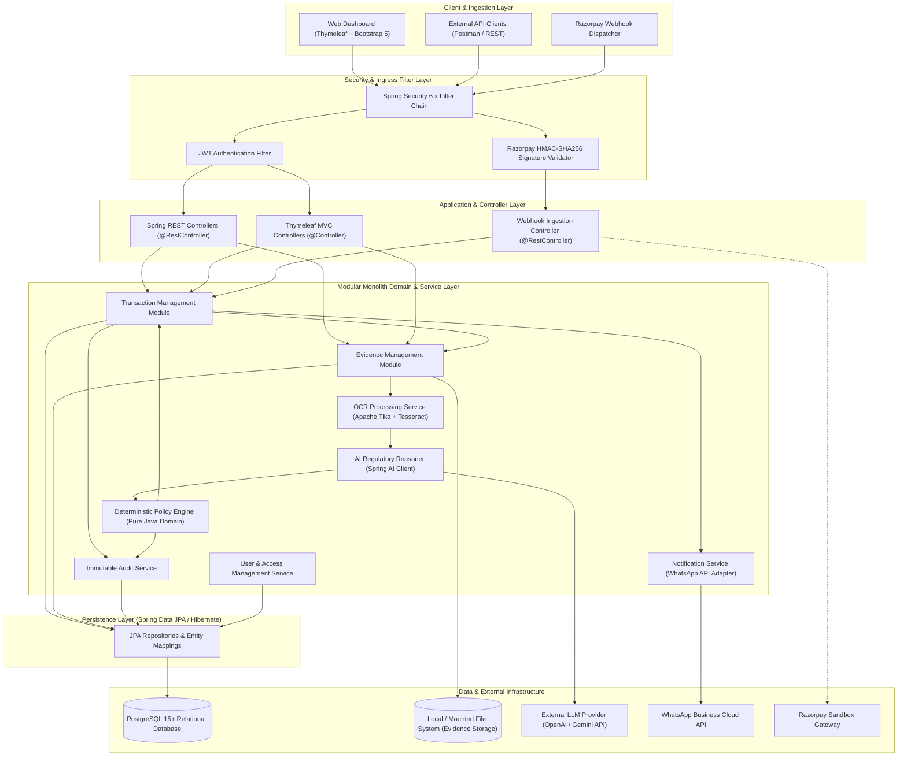
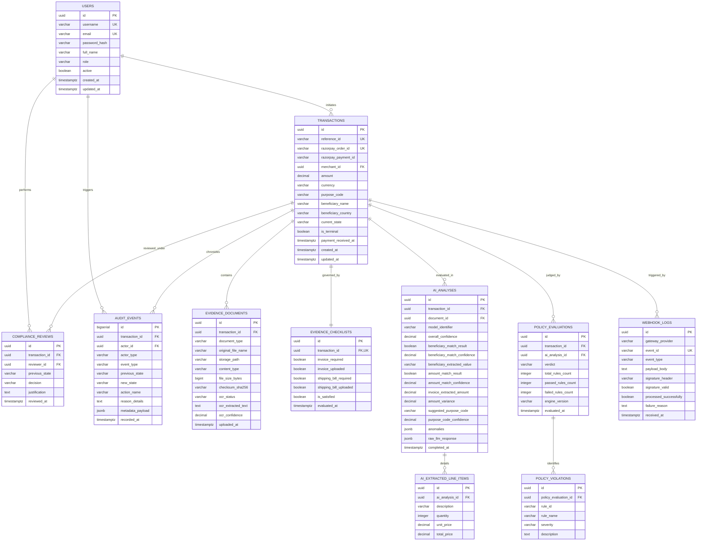
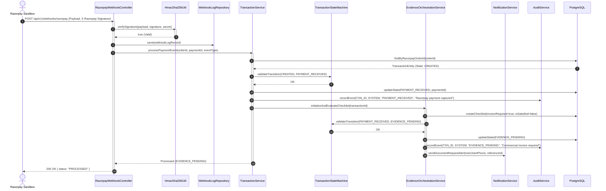
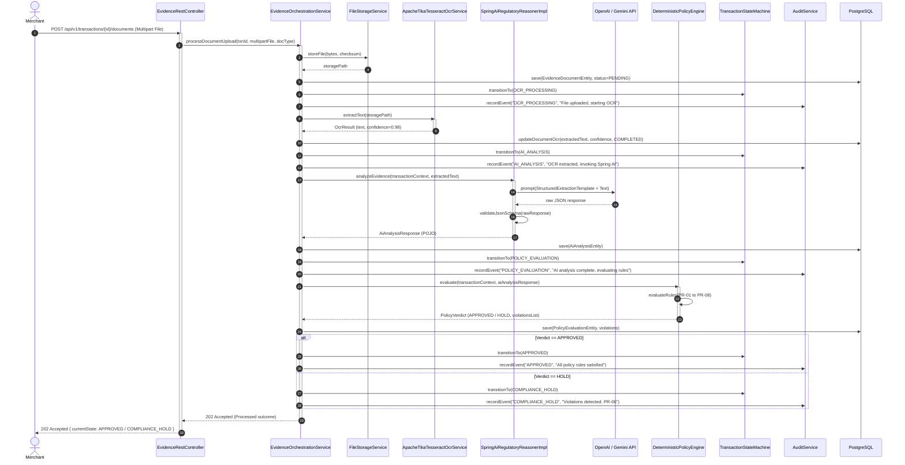
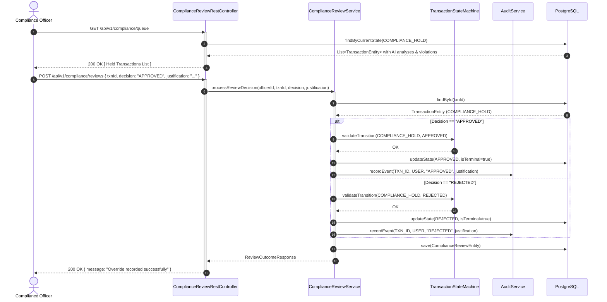
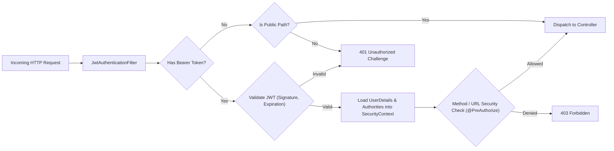

# Aegis-X — Technical Architecture Specification (TAS)

> **Document ID:** AEGISX-TAS-001  
> **Version:** 1.0  
> **Date:** 2026-09-20  
> **Status:** Implementation Ready — Phase 02  
> **Classification:** Internal Technical Design  
> **Authoritative SRS Reference:** [SRS_Aegis_X.md](file:///a:/GITHUB/Aegis-X/docs/SRS_Aegis_X.md) (v2.0)

---

## Table of Contents

1. [Executive Summary & Architectural Principles](#1-executive-summary--architectural-principles)
2. [High-Level System Architecture](#2-high-level-system-architecture)
3. [Component Architecture & Module Design](#3-component-architecture--module-design)
4. [Spring Boot Package Structure & Layout](#4-spring-boot-package-structure--layout)
5. [Data Architecture & PostgreSQL ER Diagram](#5-data-architecture--postgresql-er-diagram)
6. [Complete Database Schema DDL & Constraints](#6-complete-database-schema-ddl--constraints)
7. [Frozen Enums & Value Objects Specification](#7-frozen-enums--value-objects-specification)
8. [REST API Blueprint & Endpoint Specification](#8-rest-api-blueprint--endpoint-specification)
9. [Detailed Sequence Diagrams & Workflows](#9-detailed-sequence-diagrams--workflows)
10. [Transaction State Machine Implementation Rules](#10-transaction-state-machine-implementation-rules)
11. [Security Architecture & RBAC Matrix](#11-security-architecture--rbac-matrix)
12. [Razorpay Integration & Webhook Ingestion Design](#12-razorpay-integration--webhook-ingestion-design)
13. [AI Pipeline Design (Spring AI Regulatory Reasoner)](#13-ai-pipeline-design-spring-ai-regulatory-reasoner)
14. [Deterministic Policy Engine Specification](#14-deterministic-policy-engine-specification)
15. [Immutable Audit Trail Architecture](#15-immutable-audit-trail-architecture)
16. [Deployment & Infrastructure Architecture](#16-deployment--infrastructure-architecture)
17. [Architecture Decision Records (ADRs)](#17-architecture-decision-records-adrs)

---

## 1. Executive Summary & Architectural Principles

### 1.1 Purpose and Scope

This Technical Architecture Specification (TAS) defines the implementation-ready software architecture for **Aegis-X**, a cross-border payment compliance and settlement orchestration platform. It translates the functional, regulatory, and non-functional requirements detailed in the [Phase 01 SRS](file:///a:/GITHUB/Aegis-X/docs/SRS_Aegis_X.md) into concrete, testable architectural patterns for a **Java 21 / Spring Boot 3 modular monolith** running against **MySQL 8.4 LTS**.

### 1.2 Core Architectural Principles

```
┌────────────────────────────────────────────────────────────────────────────────────────┐
│                                 THE GOLDEN PRINCIPLE                                   │
│                                                                                        │
│               AI is an ADVISOR. Java is the SOLE COMPLIANCE AUTHORITY.                 │
│                                                                                        │
│   • AI parses unstructured text, extracts structured entities, and computes match      │
│     confidence metrics. It NEVER approves, rejects, holds, or settles a transaction.    │
│   • The deterministic Java Policy Engine evaluates hard rules against system state     │
│     and AI output. ONLY Java transitions transaction states and authorizes settlement. │
└────────────────────────────────────────────────────────────────────────────────────────┘
```

1. **Deterministic Authority (SRS §1.4, AG-01, AG-02):** Probabilistic AI model outputs (Spring AI) are strictly advisory. Final state mutations (`APPROVED`, `COMPLIANCE_HOLD`, `REJECTED`) are executed exclusively by pure Java domain code via deterministic rules.
2. **Immutable Traceability (SRS §1.4, AG-03):** Every state change, policy evaluation, webhook event, and human override generates an append-only audit event in PostgreSQL with actor context and timestamp.
3. **Single Source of Truth (SRS AG-04):** PostgreSQL persists the entire system state. In-memory data is ephemeral; no caching layer (e.g., Redis) or distributed broker (e.g., Kafka) is authoritative.
4. **Synchronous In-Process Monolith (SRS AG-06, AG-07):** The application is packaged as a single deployable artifact. Inter-module communication occurs via strongly-typed Java method invocations within Spring Application context transactions.

---

## 2. High-Level System Architecture

### 2.1 Layered Architecture Overview

Aegis-X is structured as a classical, clean Layered Architecture with strict unidirectional dependency flow from Presentation down to Persistence:



---

## 3. Component Architecture & Module Design

### 3.1 Module Inventory & Responsibilities

The system consists of 12 internal logical modules organized within the Spring Boot application:

| Module Identifier | Package Root | Primary Responsibility | Key Collaborators |
|---|---|---|---|
| **`auth`** | `com.aegisx.auth` | JWT creation, validation, login endpoints, token blacklist, Spring Security configuration | `user` |
| **`user`** | `com.aegisx.user` | User lifecycle, credential management, role assignment (`MERCHANT`, `COMPLIANCE_OFFICER`, `ADMIN`) | `auth` |
| **`payment`** | `com.aegisx.payment` | Razorpay webhook reception, HMAC-SHA256 signature verification, idempotency checking | `transaction`, `audit` |
| **`transaction`** | `com.aegisx.transaction` | Core state machine manager, transaction lifecycle, status transitions, query facades | `evidence`, `policy`, `audit` |
| **`evidence`** | `com.aegisx.evidence` | Document upload, MIME validation, storage abstraction, checklist satisfaction tracking | `ocr`, `transaction`, `audit` |
| **`ocr`** | `com.aegisx.ocr` | Document content extraction using Apache Tika metadata parser and Tesseract OCR engine | `ai`, `evidence` |
| **`ai`** | `com.aegisx.ai` | Spring AI prompt generation, LLM communication, structured JSON parsing, advisory scoring | `policy`, `ocr` |
| **`policy`** | `com.aegisx.policy` | Deterministic Java compliance engine, rule execution (`PR-01` to `PR-08`), verdict formulation | `transaction`, `audit` |
| **`review`** | `com.aegisx.review` | Compliance officer review queue, decision capture (`APPROVED`/`REJECTED`), mandatory justification | `transaction`, `audit` |
| **`audit`** | `com.aegisx.audit` | Append-only event store, timeline generation, non-repudiation tracking | All modules |
| **`notification`**| `com.aegisx.notification` | Asynchronous WhatsApp message dispatch for missing documents and status updates | `evidence`, `transaction` |
| **`dashboard`** | `com.aegisx.dashboard` | Thymeleaf view controllers, UI model preparation, client-side rendering support | `transaction`, `review` |

---

## 4. Spring Boot Package Structure & Layout

The project follows a Domain-Driven, feature-modular package organization under `com.aegisx`:

```text
com.aegisx/
├── AegisXApplication.java                   # Spring Boot main entrypoint
│
├── common/                                  # Cross-cutting primitives & utilities
│   ├── config/
│   │   ├── AppProperties.java               # Type-safe @ConfigurationProperties
│   │   ├── OpenApiConfig.java               # Swagger / OpenAPI specification
│   │   └── WebMvcConfig.java                # CORS, formatters, interceptors
│   ├── exception/
│   │   ├── BaseDomainException.java         # Abstract application exception
│   │   ├── EntityNotFoundException.java     # 404 handler
│   │   ├── InvalidStateTransitionException.java # 409 conflict on state machine
│   │   ├── SecurityValidationException.java # 401/403 errors
│   │   └── GlobalExceptionHandler.java      # @ControllerAdvice mapping to RFC 7807
│   └── util/
│       ├── HmacSha256Util.java              # Razorpay signature validator
│       └── DateTimeUtil.java                # UTC timestamp formatter
│
├── auth/                                    # Authentication & Security Module
│   ├── controller/
│   │   └── AuthRestController.java          # /api/v1/auth/login, /refresh
│   ├── dto/
│   │   ├── AuthRequest.java
│   │   ├── AuthResponse.java
│   │   └── JwtUserDetails.java
│   ├── security/
│   │   ├── JwtAuthenticationFilter.java     # Per-request JWT parser & context loader
│   │   ├── JwtTokenProvider.java            # JJWT token generation & validation
│   │   ├── SecurityConfiguration.java       # SecurityFilterChain bean definitions
│   │   └── RestAuthenticationEntryPoint.java# 401 challenge responder
│   └── service/
│       └── AuthService.java
│
├── user/                                    # User Management Module
│   ├── entity/
│   │   └── UserEntity.java                  # users table mapping
│   ├── repository/
│   │   └── UserRepository.java
│   └── service/
│       └── UserService.java
│
├── payment/                                 # Payment & Webhook Integration Module
│   ├── controller/
│   │   └── RazorpayWebhookController.java   # /api/v1/webhooks/razorpay
│   ├── dto/
│   │   ├── RazorpayWebhookPayload.java      # Jackson bindings for Razorpay JSON
│   │   └── PaymentInitiateRequest.java      # Merchant simulated request
│   └── service/
│       ├── WebhookVerificationService.java  # Signature validator
│       └── PaymentProcessingService.java    # Webhook ingestion logic
│
├── transaction/                             # Transaction Lifecycle & State Machine
│   ├── entity/
│   │   └── TransactionEntity.java           # transactions table mapping
│   ├── statemachine/
│   │   ├── TransactionState.java            # Frozen enum (CREATED -> APPROVED, etc.)
│   │   ├── TransactionEvent.java            # Trigger events (PAYMENT_RECEIVED, etc.)
│   │   └── TransactionStateMachine.java     # Guard conditions & legal transition validator
│   ├── repository/
│   │   └── TransactionRepository.java
│   ├── dto/
│   │   ├── TransactionResponse.java
│   │   └── TransactionFilterCriteria.java
│   └── service/
│       └── TransactionService.java          # Orchestrates transitions & dispatches pipeline
│
├── evidence/                                # Evidence & Document Management Module
│   ├── entity/
│   │   ├── EvidenceDocumentEntity.java      # evidence_documents table mapping
│   │   └── EvidenceChecklistEntity.java     # evidence_checklists table mapping
│   ├── repository/
│   │   ├── EvidenceDocumentRepository.java
│   │   └── EvidenceChecklistRepository.java
│   ├── storage/
│   │   ├── FileStorageService.java          # Interface for storage
│   │   └── LocalFileSystemStorageService.java # Disk-backed storage implementation
│   ├── controller/
│   │   └── EvidenceRestController.java      # /api/v1/transactions/{id}/documents
│   └── service/
│       └── EvidenceOrchestrationService.java# Checklist validation & workflow dispatcher
│
├── ocr/                                     # OCR Text Extraction Engine
│   ├── dto/
│   │   └── OcrResult.java                   # Extracted text, bounding data, confidence
│   └── service/
│       ├── OcrService.java                  # Interface
│       └── ApacheTikaTesseractOcrService.java # Tika parser + Tesseract wrapper
│
├── ai/                                      # AI Regulatory Reasoner (Spring AI)
│   ├── config/
│   │   └── SpringAiClientConfig.java        # ChatClient and model configuration
│   ├── dto/
│   │   ├── AiAnalysisRequest.java
│   │   ├── AiAnalysisResponse.java          # Schema-conformant structured extraction JSON
│   │   └── AiBeneficiaryMatch.java
│   ├── prompt/
│   │   └── RegulatoryPromptTemplates.java   # System and User prompt templates
│   └── service/
│       ├── AiRegulatoryReasonerService.java # Interface
│       └── SpringAiRegulatoryReasonerImpl.java # Spring AI implementation with retry/timeout
│
├── policy/                                  # Deterministic Java Policy Engine
│   ├── model/
│   │   ├── PolicyEvaluationContext.java     # Aggregated inputs (Txn, Evidence, AI, Config)
│   │   ├── PolicyVerdict.java               # APPROVED / HOLD outcome
│   │   ├── PolicyViolation.java             # Rule failure details
│   │   └── PolicyVerdictType.java           # Enum (APPROVED, HOLD)
│   ├── rules/
│   │   ├── ComplianceRule.java              # Strategy interface
│   │   ├── PR01_InvoicePresenceRule.java
│   │   ├── PR02_BeneficiaryMatchRule.java
│   │   ├── PR03_AmountMatchRule.java
│   │   ├── PR04_PurposeCodeValidityRule.java
│   │   ├── PR05_OcrConfidenceRule.java
│   │   ├── PR06_AiConfidenceRule.java
│   │   ├── PR07_EvidenceCompletenessRule.java
│   │   └── PR08_NoCriticalAnomaliesRule.java
│   └── engine/
│       └── DeterministicPolicyEngine.java   # Evaluates rules sequentially & aggregates violations
│
├── review/                                  # Human Compliance Review Module
│   ├── controller/
│   │   └── ComplianceReviewRestController.java # /api/v1/compliance/reviews
│   ├── dto/
│   │   ├── ReviewDecisionRequest.java       # Justification, action (APPROVE/REJECT)
│   │   └── ReviewQueueItemResponse.java
│   └── service/
│       └── ComplianceReviewService.java     # Validates reviewer role, applies override
│
├── audit/                                   # Immutable Audit Log Service
│   ├── entity/
│   │   └── AuditEventEntity.java            # audit_events table mapping
│   ├── repository/
│   │   └── AuditEventRepository.java
│   ├── dto/
│   │   └── AuditTimelineEntryResponse.java
│   └── service/
│       └── AuditService.java                # Writes audit entries within transaction context
│
├── notification/                            # Notification Dispatcher
│   ├── client/
│   │   └── WhatsAppApiClient.java           # RestClient / WebClient wrapper for Meta API
│   ├── dto/
│   │   └── WhatsAppNotificationPayload.java
│   └── service/
│       └── NotificationService.java
│
└── dashboard/                               # Server-Rendered Thymeleaf Dashboard
    └── controller/
        ├── MerchantDashboardViewController.java
        ├── ComplianceDashboardViewController.java
        └── AdminDashboardViewController.java
```

---

## 5. Data Architecture & PostgreSQL ER Diagram

### 5.1 Entity Relationship Diagram



---

## 6. Complete Database Schema DDL & Constraints

The PostgreSQL 15+ schema employs explicit UUID primary keys, foreign key referential integrity with cascading safeguards, numeric types for monetary safety, and jsonb columns for structured advisory output.

```sql
-- ============================================================================
-- Aegis-X Database Schema Definition (PostgreSQL 15+)
-- File: schema.sql
-- ============================================================================

CREATE EXTENSION IF NOT EXISTS "uuid-ossp";

-- ----------------------------------------------------------------------------
-- 1. USERS & ACCESS
-- ----------------------------------------------------------------------------
CREATE TABLE users (
    id UUID PRIMARY KEY DEFAULT gen_random_uuid(),
    username VARCHAR(50) NOT NULL UNIQUE,
    email VARCHAR(100) NOT NULL UNIQUE,
    password_hash VARCHAR(255) NOT NULL,
    full_name VARCHAR(100) NOT NULL,
    role VARCHAR(30) NOT NULL,
    active BOOLEAN NOT NULL DEFAULT TRUE,
    created_at TIMESTAMPTZ NOT NULL DEFAULT CURRENT_TIMESTAMP,
    updated_at TIMESTAMPTZ NOT NULL DEFAULT CURRENT_TIMESTAMP,
    CONSTRAINT chk_user_role CHECK (role IN ('ROLE_MERCHANT', 'ROLE_COMPLIANCE_OFFICER', 'ROLE_ADMIN'))
);

CREATE INDEX idx_users_username ON users(username);
CREATE INDEX idx_users_email ON users(email);

-- ----------------------------------------------------------------------------
-- 2. TRANSACTIONS
-- ----------------------------------------------------------------------------
CREATE TABLE transactions (
    id UUID PRIMARY KEY DEFAULT gen_random_uuid(),
    reference_id VARCHAR(50) NOT NULL UNIQUE,
    razorpay_order_id VARCHAR(100) NOT NULL UNIQUE,
    razorpay_payment_id VARCHAR(100),
    merchant_id UUID NOT NULL REFERENCES users(id) ON DELETE RESTRICT,
    amount NUMERIC(15, 2) NOT NULL,
    currency VARCHAR(3) NOT NULL,
    purpose_code VARCHAR(10) NOT NULL,
    beneficiary_name VARCHAR(150) NOT NULL,
    beneficiary_country VARCHAR(2) NOT NULL,
    current_state VARCHAR(40) NOT NULL,
    is_terminal BOOLEAN NOT NULL DEFAULT FALSE,
    payment_received_at TIMESTAMPTZ,
    created_at TIMESTAMPTZ NOT NULL DEFAULT CURRENT_TIMESTAMP,
    updated_at TIMESTAMPTZ NOT NULL DEFAULT CURRENT_TIMESTAMP,
    CONSTRAINT chk_txn_currency CHECK (currency IN ('USD', 'EUR', 'GBP', 'INR', 'SGD')),
    CONSTRAINT chk_txn_amount CHECK (amount > 0),
    CONSTRAINT chk_txn_state CHECK (current_state IN (
        'CREATED',
        'PAYMENT_RECEIVED',
        'PAYMENT_FAILED',
        'EVIDENCE_PENDING',
        'OCR_PROCESSING',
        'OCR_FAILED',
        'AI_ANALYSIS',
        'AI_ANALYSIS_FAILED',
        'POLICY_EVALUATION',
        'APPROVED',
        'COMPLIANCE_HOLD',
        'REJECTED'
    ))
);

CREATE INDEX idx_transactions_reference_id ON transactions(reference_id);
CREATE INDEX idx_transactions_current_state ON transactions(current_state);
CREATE INDEX idx_transactions_merchant_id ON transactions(merchant_id);
CREATE INDEX idx_transactions_rzp_order ON transactions(razorpay_order_id);

-- ----------------------------------------------------------------------------
-- 3. EVIDENCE CHECKLISTS
-- ----------------------------------------------------------------------------
CREATE TABLE evidence_checklists (
    id UUID PRIMARY KEY DEFAULT gen_random_uuid(),
    transaction_id UUID NOT NULL UNIQUE REFERENCES transactions(id) ON DELETE CASCADE,
    invoice_required BOOLEAN NOT NULL DEFAULT TRUE,
    invoice_uploaded BOOLEAN NOT NULL DEFAULT FALSE,
    shipping_bill_required BOOLEAN NOT NULL DEFAULT FALSE,
    shipping_bill_uploaded BOOLEAN NOT NULL DEFAULT FALSE,
    is_satisfied BOOLEAN NOT NULL DEFAULT FALSE,
    evaluated_at TIMESTAMPTZ NOT NULL DEFAULT CURRENT_TIMESTAMP
);

CREATE INDEX idx_checklist_txn_id ON evidence_checklists(transaction_id);

-- ----------------------------------------------------------------------------
-- 4. EVIDENCE DOCUMENTS
-- ----------------------------------------------------------------------------
CREATE TABLE evidence_documents (
    id UUID PRIMARY KEY DEFAULT gen_random_uuid(),
    transaction_id UUID NOT NULL REFERENCES transactions(id) ON DELETE CASCADE,
    document_type VARCHAR(40) NOT NULL,
    original_file_name VARCHAR(255) NOT NULL,
    storage_path VARCHAR(500) NOT NULL,
    content_type VARCHAR(100) NOT NULL,
    file_size_bytes BIGINT NOT NULL,
    checksum_sha256 VARCHAR(64) NOT NULL,
    ocr_status VARCHAR(30) NOT NULL DEFAULT 'PENDING',
    ocr_extracted_text TEXT,
    ocr_confidence NUMERIC(5, 4),
    uploaded_at TIMESTAMPTZ NOT NULL DEFAULT CURRENT_TIMESTAMP,
    CONSTRAINT chk_doc_type CHECK (document_type IN ('COMMERCIAL_INVOICE', 'SHIPPING_BILL', 'PACKING_LIST', 'CERTIFICATE_OF_ORIGIN')),
    CONSTRAINT chk_doc_ocr_status CHECK (ocr_status IN ('PENDING', 'PROCESSING', 'COMPLETED', 'FAILED'))
);

CREATE INDEX idx_documents_txn_id ON evidence_documents(transaction_id);

-- ----------------------------------------------------------------------------
-- 5. AI ANALYSES
-- ----------------------------------------------------------------------------
CREATE TABLE ai_analyses (
    id UUID PRIMARY KEY DEFAULT gen_random_uuid(),
    transaction_id UUID NOT NULL REFERENCES transactions(id) ON DELETE CASCADE,
    document_id UUID REFERENCES evidence_documents(id) ON DELETE SET NULL,
    model_identifier VARCHAR(100) NOT NULL,
    overall_confidence NUMERIC(5, 4) NOT NULL,
    beneficiary_match_result BOOLEAN NOT NULL,
    beneficiary_match_confidence NUMERIC(5, 4) NOT NULL,
    beneficiary_extracted_value VARCHAR(150),
    amount_match_result BOOLEAN NOT NULL,
    amount_match_confidence NUMERIC(5, 4) NOT NULL,
    invoice_extracted_amount NUMERIC(15, 2),
    amount_variance NUMERIC(15, 2) NOT NULL DEFAULT 0.00,
    suggested_purpose_code VARCHAR(10),
    purpose_code_confidence NUMERIC(5, 4),
    anomalies JSONB NOT NULL DEFAULT '[]'::jsonb,
    raw_llm_response JSONB NOT NULL,
    completed_at TIMESTAMPTZ NOT NULL DEFAULT CURRENT_TIMESTAMP
);

CREATE INDEX idx_ai_analysis_txn_id ON ai_analyses(transaction_id);

-- ----------------------------------------------------------------------------
-- 6. AI EXTRACTED LINE ITEMS
-- ----------------------------------------------------------------------------
CREATE TABLE ai_extracted_line_items (
    id UUID PRIMARY KEY DEFAULT gen_random_uuid(),
    ai_analysis_id UUID NOT NULL REFERENCES ai_analyses(id) ON DELETE CASCADE,
    description VARCHAR(255) NOT NULL,
    quantity INTEGER NOT NULL DEFAULT 1,
    unit_price NUMERIC(15, 2) NOT NULL,
    total_price NUMERIC(15, 2) NOT NULL
);

CREATE INDEX idx_ai_line_items_analysis ON ai_extracted_line_items(ai_analysis_id);

-- ----------------------------------------------------------------------------
-- 7. POLICY EVALUATIONS & VIOLATIONS
-- ----------------------------------------------------------------------------
CREATE TABLE policy_evaluations (
    id UUID PRIMARY KEY DEFAULT gen_random_uuid(),
    transaction_id UUID NOT NULL REFERENCES transactions(id) ON DELETE CASCADE,
    ai_analysis_id UUID REFERENCES ai_analyses(id) ON DELETE SET NULL,
    verdict VARCHAR(20) NOT NULL,
    total_rules_count INTEGER NOT NULL,
    passed_rules_count INTEGER NOT NULL,
    failed_rules_count INTEGER NOT NULL,
    engine_version VARCHAR(20) NOT NULL DEFAULT '1.0.0',
    evaluated_at TIMESTAMPTZ NOT NULL DEFAULT CURRENT_TIMESTAMP,
    CONSTRAINT chk_policy_verdict CHECK (verdict IN ('APPROVED', 'HOLD'))
);

CREATE INDEX idx_policy_eval_txn_id ON policy_evaluations(transaction_id);

CREATE TABLE policy_violations (
    id UUID PRIMARY KEY DEFAULT gen_random_uuid(),
    policy_evaluation_id UUID NOT NULL REFERENCES policy_evaluations(id) ON DELETE CASCADE,
    rule_id VARCHAR(20) NOT NULL,
    rule_name VARCHAR(100) NOT NULL,
    severity VARCHAR(20) NOT NULL,
    description TEXT NOT NULL,
    CONSTRAINT chk_violation_sev CHECK (severity IN ('CRITICAL', 'HIGH', 'MEDIUM', 'LOW'))
);

CREATE INDEX idx_violations_eval_id ON policy_violations(policy_evaluation_id);

-- ----------------------------------------------------------------------------
-- 8. COMPLIANCE REVIEWS (Human Decision Log)
-- ----------------------------------------------------------------------------
CREATE TABLE compliance_reviews (
    id UUID PRIMARY KEY DEFAULT gen_random_uuid(),
    transaction_id UUID NOT NULL REFERENCES transactions(id) ON DELETE CASCADE,
    reviewer_id UUID NOT NULL REFERENCES users(id) ON DELETE RESTRICT,
    previous_state VARCHAR(40) NOT NULL,
    decision VARCHAR(20) NOT NULL,
    justification TEXT NOT NULL,
    reviewed_at TIMESTAMPTZ NOT NULL DEFAULT CURRENT_TIMESTAMP,
    CONSTRAINT chk_review_decision CHECK (decision IN ('APPROVED', 'REJECTED'))
);

CREATE INDEX idx_reviews_txn_id ON compliance_reviews(transaction_id);

-- ----------------------------------------------------------------------------
-- 9. IMMUTABLE AUDIT EVENTS
-- ----------------------------------------------------------------------------
CREATE TABLE audit_events (
    id BIGSERIAL PRIMARY KEY,
    transaction_id UUID NOT NULL REFERENCES transactions(id) ON DELETE CASCADE,
    actor_id UUID REFERENCES users(id) ON DELETE SET NULL,
    actor_type VARCHAR(30) NOT NULL,
    event_type VARCHAR(50) NOT NULL,
    previous_state VARCHAR(40),
    new_state VARCHAR(40) NOT NULL,
    action_name VARCHAR(100) NOT NULL,
    reason_details TEXT,
    metadata_payload JSONB NOT NULL DEFAULT '{}'::jsonb,
    recorded_at TIMESTAMPTZ NOT NULL DEFAULT CURRENT_TIMESTAMP,
    CONSTRAINT chk_actor_type CHECK (actor_type IN ('SYSTEM', 'USER', 'GATEWAY'))
);

CREATE INDEX idx_audit_txn_id ON audit_events(transaction_id);
CREATE INDEX idx_audit_recorded_at ON audit_events(recorded_at);

-- ----------------------------------------------------------------------------
-- 10. WEBHOOK INGESTION LOGS
-- ----------------------------------------------------------------------------
CREATE TABLE webhook_logs (
    id UUID PRIMARY KEY DEFAULT gen_random_uuid(),
    gateway_provider VARCHAR(30) NOT NULL DEFAULT 'RAZORPAY',
    event_id VARCHAR(100) NOT NULL UNIQUE,
    event_type VARCHAR(100) NOT NULL,
    payload_body TEXT NOT NULL,
    signature_header VARCHAR(255) NOT NULL,
    signature_valid BOOLEAN NOT NULL,
    processed_successfully BOOLEAN NOT NULL DEFAULT FALSE,
    failure_reason TEXT,
    received_at TIMESTAMPTZ NOT NULL DEFAULT CURRENT_TIMESTAMP
);

CREATE INDEX idx_webhook_event_id ON webhook_logs(event_id);
```

---

## 7. Frozen Enums & Value Objects Specification

### 7.1 TransactionStatus (`com.aegisx.transaction.statemachine.TransactionState`)

```java
package com.aegisx.transaction.statemachine;

public enum TransactionState {
    CREATED(false, "Payment request registered in system, awaiting gateway event"),
    PAYMENT_RECEIVED(false, "Gateway confirmed payment capture, pending evidence validation"),
    PAYMENT_FAILED(true, "Gateway reported payment authorization failure (Terminal)"),
    EVIDENCE_PENDING(false, "Awaiting upload of required compliance documents"),
    OCR_PROCESSING(false, "Document uploaded; OCR text extraction in progress"),
    OCR_FAILED(false, "OCR text extraction failed or yielded unreadable content"),
    AI_ANALYSIS(false, "OCR text submitted to Spring AI for regulatory entity extraction"),
    AI_ANALYSIS_FAILED(false, "Spring AI service error, schema mismatch, or timeout"),
    POLICY_EVALUATION(false, "Executing deterministic Java policy rules"),
    APPROVED(true, "All compliance rules satisfied or officer approved; settlement cleared (Terminal)"),
    COMPLIANCE_HOLD(false, "One or more deterministic rules failed; awaiting human officer review"),
    REJECTED(true, "Compliance officer rejected the transaction (Terminal)");

    private final boolean terminal;
    private final String description;

    TransactionState(boolean terminal, String description) {
        this.terminal = terminal;
        this.description = description;
    }

    public boolean isTerminal() {
        return terminal;
    }

    public String getDescription() {
        return description;
    }
}
```

### 7.2 UserRole (`com.aegisx.user.entity.UserRole`)

```java
package com.aegisx.user.entity;

public enum UserRole {
    ROLE_MERCHANT("Initiates payments and uploads documentation"),
    ROLE_COMPLIANCE_OFFICER("Reviews held transactions and issues approval/rejection overrides"),
    ROLE_ADMIN("Manages platform users, system configurations, and system health");

    private final String description;

    UserRole(String description) {
        this.description = description;
    }

    public String getDescription() {
        return description;
    }
}
```

### 7.3 PolicyVerdictType (`com.aegisx.policy.model.PolicyVerdictType`)

```java
package com.aegisx.policy.model;

public enum PolicyVerdictType {
    APPROVED("All mandatory compliance checks passed with zero violations"),
    HOLD("One or more compliance violations detected; requires compliance officer review");

    private final String description;

    PolicyVerdictType(String description) {
        this.description = description;
    }
}
```

### 7.4 DocumentType (`com.aegisx.evidence.entity.DocumentType`)

```java
package com.aegisx.evidence.entity;

public enum DocumentType {
    COMMERCIAL_INVOICE("Mandatory commercial bill detailing buyer, seller, and line items"),
    SHIPPING_BILL("Export document certifying physical dispatch of goods"),
    PACKING_LIST("Detailed breakdown of cargo and container packing"),
    CERTIFICATE_OF_ORIGIN("Official certification of manufacturing jurisdiction");

    private final String description;

    DocumentType(String description) {
        this.description = description;
    }
}
```

---

## 8. REST API Blueprint & Endpoint Specification

All API responses follow the standard JSON envelope structure, with HTTP status codes matching RFC 9110. Error responses conform to **RFC 7807 (Problem Details for HTTP APIs)**.

### 8.1 API Endpoint Catalog

| HTTP Method | Resource Path | Description | Required Role |
|---|---|---|---|
| `POST` | `/api/v1/auth/login` | Authenticate credentials and receive JWT | Public |
| `POST` | `/api/v1/webhooks/razorpay` | Ingest Razorpay sandbox payment webhooks | Public (HMAC Verified) |
| `POST` | `/api/v1/transactions` | Create a new cross-border payment request | `ROLE_MERCHANT` |
| `GET` | `/api/v1/transactions/{id}` | Fetch transaction state, evidence, & audit history | `ROLE_MERCHANT`, `ROLE_COMPLIANCE_OFFICER`, `ROLE_ADMIN` |
| `GET` | `/api/v1/transactions` | Query and filter transaction lists | `ROLE_MERCHANT`, `ROLE_COMPLIANCE_OFFICER`, `ROLE_ADMIN` |
| `POST` | `/api/v1/transactions/{id}/documents` | Upload PDF/image evidence for OCR/AI processing | `ROLE_MERCHANT` |
| `GET` | `/api/v1/compliance/queue` | Query transactions currently in `COMPLIANCE_HOLD` | `ROLE_COMPLIANCE_OFFICER`, `ROLE_ADMIN` |
| `POST` | `/api/v1/compliance/reviews` | Submit officer override (`APPROVED`/`REJECTED`) | `ROLE_COMPLIANCE_OFFICER` |
| `GET` | `/api/v1/transactions/{id}/audit` | Retrieve complete immutable audit timeline | `ROLE_COMPLIANCE_OFFICER`, `ROLE_ADMIN` |

---

### 8.2 Detailed Endpoint Specifications

#### 8.2.1 `POST /api/v1/auth/login`
- **Headers:** `Content-Type: application/json`
- **Request Body:**
```json
{
  "username": "abc_merchant",
  "password": "SecurePassword123!"
}
```
- **Response `200 OK`:**
```json
{
  "token": "eyJhbGciOiJIUzI1NiIsInR5cCI6IkpXVCJ9...",
  "tokenType": "Bearer",
  "expiresInSeconds": 86400,
  "userId": "b4e870c5-59b4-42b7-8db1-c58473ecb111",
  "username": "abc_merchant",
  "role": "ROLE_MERCHANT"
}
```

#### 8.2.2 `POST /api/v1/webhooks/razorpay`
- **Headers:**
  - `Content-Type: application/json`
  - `X-Razorpay-Signature: 4a6828b8b087093259b3806f7b...`
- **Request Body:**
```json
{
  "entity": "event",
  "account_id": "acc_P1029384",
  "event": "payment.captured",
  "contains": ["payment"],
  "payload": {
    "payment": {
      "entity": {
        "id": "pay_O09283748291",
        "order_id": "order_H891238491",
        "amount": 200000,
        "currency": "USD",
        "status": "captured",
        "notes": {
          "reference_id": "TXN-20260920-001"
        }
      }
    }
  },
  "created_at": 1758369600
}
```
- **Response `200 OK`:**
```json
{
  "status": "PROCESSED",
  "transactionId": "f7d54b8a-3670-4f52-87ad-c55208575024",
  "currentState": "EVIDENCE_PENDING"
}
```

#### 8.2.3 `POST /api/v1/transactions/{id}/documents`
- **Headers:**
  - `Authorization: Bearer <jwt_token>`
  - `Content-Type: multipart/form-data`
- **Form Data:**
  - `file`: `invoice_INV2048.pdf` (Binary, application/pdf)
  - `documentType`: `COMMERCIAL_INVOICE`
- **Response `202 Accepted`:**
```json
{
  "documentId": "c88f1190-7d84-4fe1-968e-28f09912bebc",
  "transactionId": "f7d54b8a-3670-4f52-87ad-c55208575024",
  "documentType": "COMMERCIAL_INVOICE",
  "originalFileName": "invoice_INV2048.pdf",
  "fileSizeBytes": 145020,
  "currentState": "APPROVED",
  "message": "Document processed, OCR completed, AI analysis performed, and deterministic policy engine evaluated successfully."
}
```

#### 8.2.4 `POST /api/v1/compliance/reviews`
- **Headers:**
  - `Authorization: Bearer <jwt_token>`
  - `Content-Type: application/json`
- **Request Body:**
```json
{
  "transactionId": "f7d54b8a-3670-4f52-87ad-c55208575024",
  "decision": "APPROVED",
  "justification": "Verified export license and matched manual letter of credit. Beneficiary name spelling discrepancy resolved via verified tax registration."
}
```
- **Response `200 OK`:**
```json
{
  "transactionId": "f7d54b8a-3670-4f52-87ad-c55208575024",
  "previousState": "COMPLIANCE_HOLD",
  "newState": "APPROVED",
  "reviewedBy": "officer_sharma",
  "reviewedAt": "2026-09-20T16:45:00Z",
  "message": "Compliance override recorded. Transaction state transitioned to APPROVED."
}
```

---

## 9. Detailed Sequence Diagrams & Workflows

### 9.1 Sequence 1: Razorpay Webhook Ingestion & State Initialization



---

### 9.2 Sequence 2: Document Upload, OCR, AI Regulatory Reasoner, & Policy Engine



---

### 9.3 Sequence 3: Compliance Hold Human Review & Override



---

## 10. Transaction State Machine Implementation Rules

### 10.1 Complete Legal State Transitions Matrix

| Transition ID | Source State | Target State | Triggering Event | Guard Condition | Actor |
|---|---|---|---|---|---|
| **T1** | `CREATED` | `PAYMENT_RECEIVED` | `PAYMENT_SUCCESS_WEBHOOK` | Razorpay webhook signature valid & payment status `captured` | Gateway / System |
| **T2** | `CREATED` | `PAYMENT_FAILED` | `PAYMENT_FAILURE_WEBHOOK` | Razorpay webhook signature valid & payment status `failed` | Gateway / System |
| **T3** | `PAYMENT_RECEIVED` | `EVIDENCE_PENDING` | `CHECKLIST_INITIALIZED` | Mandatory checklist rules require one or more documents | System |
| **T4** | `EVIDENCE_PENDING` | `OCR_PROCESSING` | `DOCUMENT_UPLOADED` | Valid MIME type, non-zero file size, checksum recorded | Merchant |
| **T5** | `OCR_PROCESSING` | `AI_ANALYSIS` | `OCR_COMPLETED` | Extracted text length > 10 chars, OCR confidence > 0.0 | System |
| **T6** | `OCR_PROCESSING` | `OCR_FAILED` | `OCR_ERROR` | OCR threw exception or extracted text is empty | System |
| **T7** | `AI_ANALYSIS` | `POLICY_EVALUATION` | `AI_COMPLETED` | AI response matches JSON schema without parsing error | System |
| **T8** | `AI_ANALYSIS` | `AI_ANALYSIS_FAILED` | `AI_ERROR_OR_TIMEOUT` | Spring AI call timed out or returned malformed payload | System |
| **T9** | `POLICY_EVALUATION`| `APPROVED` | `POLICY_PASSED` | Pure Java Policy Engine returns zero rule violations | System (Java) |
| **T10**| `POLICY_EVALUATION`| `COMPLIANCE_HOLD` | `POLICY_FAILED` | Policy Engine detected ≥ 1 rule violation (`PR-01` to `PR-08`) | System (Java) |
| **T11**| `COMPLIANCE_HOLD` | `APPROVED` | `OFFICER_APPROVED` | Officer authenticated (`ROLE_COMPLIANCE_OFFICER`), non-empty justification | Human Officer |
| **T12**| `COMPLIANCE_HOLD` | `REJECTED` | `OFFICER_REJECTED` | Officer authenticated (`ROLE_COMPLIANCE_OFFICER`), non-empty justification | Human Officer |
| **T13**| `OCR_FAILED` | `EVIDENCE_PENDING` | `RETRY_UPLOAD` | Merchant initiates re-upload or admin reset | Merchant / Admin |
| **T14**| `AI_ANALYSIS_FAILED`| `EVIDENCE_PENDING` | `RETRY_PIPELINE` | System retry exhausted or admin triggers re-run | System / Admin |

---

### 10.2 Explicit Illegal Transitions & Rejection Rules

Any attempt to execute a transition not explicitly listed in §10.1 throws an `InvalidStateTransitionException` and generates a `409 Conflict` HTTP response. The table below highlights critical illegal transitions that are strictly blocked by the state machine:

| Attempted Source State | Attempted Target State | Why It Is Forbidden | Enforcement Mechanism |
|---|---|---|---|
| `CREATED` | `APPROVED` | **State Skipping:** Cannot approve without payment receipt and evidence verification. | `TransactionStateMachine.java` validates source state |
| `AI_ANALYSIS` | `APPROVED` | **AI Isolation Violation:** AI is advisory only. MUST pass through `POLICY_EVALUATION`. | Strict state transition table lookup |
| `APPROVED` | `COMPLIANCE_HOLD` | **Terminal Irreversibility:** `APPROVED` is final. Settled funds cannot be returned to hold. | `isTerminal` flag check |
| `REJECTED` | `APPROVED` | **Terminal Irreversibility:** `REJECTED` transactions cannot be reopened. | `isTerminal` flag check |
| `PAYMENT_FAILED` | `PAYMENT_RECEIVED` | **Terminal Irreversibility:** Failed payment records cannot be reused. | `isTerminal` flag check |
| `EVIDENCE_PENDING` | `APPROVED` | **Rule Bypass:** Cannot approve without document upload and policy evaluation. | Strict transition matrix check |
| `COMPLIANCE_HOLD` | `OCR_PROCESSING` | **Workflow Integrity:** Must be approved or rejected by an officer; cannot silently re-ingest. | Strict transition matrix check |

---

### 10.3 State Machine Implementation Pattern

```java
package com.aegisx.transaction.statemachine;

import com.aegisx.common.exception.InvalidStateTransitionException;
import org.springframework.stereotype.Component;
import java.util.EnumMap;
import java.util.EnumSet;
import java.util.Map;
import java.util.Set;

@Component
public class TransactionStateMachine {

    private static final Map<TransactionState, Set<TransactionState>> LEGAL_TRANSITIONS = new EnumMap<>(TransactionState.class);

    static {
        LEGAL_TRANSITIONS.put(TransactionState.CREATED, 
            EnumSet.of(TransactionState.PAYMENT_RECEIVED, TransactionState.PAYMENT_FAILED));
        LEGAL_TRANSITIONS.put(TransactionState.PAYMENT_RECEIVED, 
            EnumSet.of(TransactionState.EVIDENCE_PENDING));
        LEGAL_TRANSITIONS.put(TransactionState.EVIDENCE_PENDING, 
            EnumSet.of(TransactionState.OCR_PROCESSING));
        LEGAL_TRANSITIONS.put(TransactionState.OCR_PROCESSING, 
            EnumSet.of(TransactionState.AI_ANALYSIS, TransactionState.OCR_FAILED));
        LEGAL_TRANSITIONS.put(TransactionState.OCR_FAILED, 
            EnumSet.of(TransactionState.EVIDENCE_PENDING));
        LEGAL_TRANSITIONS.put(TransactionState.AI_ANALYSIS, 
            EnumSet.of(TransactionState.POLICY_EVALUATION, TransactionState.AI_ANALYSIS_FAILED));
        LEGAL_TRANSITIONS.put(TransactionState.AI_ANALYSIS_FAILED, 
            EnumSet.of(TransactionState.EVIDENCE_PENDING));
        LEGAL_TRANSITIONS.put(TransactionState.POLICY_EVALUATION, 
            EnumSet.of(TransactionState.APPROVED, TransactionState.COMPLIANCE_HOLD));
        LEGAL_TRANSITIONS.put(TransactionState.COMPLIANCE_HOLD, 
            EnumSet.of(TransactionState.APPROVED, TransactionState.REJECTED));
        
        // Terminal states have empty sets
        LEGAL_TRANSITIONS.put(TransactionState.APPROVED, EnumSet.noneOf(TransactionState.class));
        LEGAL_TRANSITIONS.put(TransactionState.REJECTED, EnumSet.noneOf(TransactionState.class));
        LEGAL_TRANSITIONS.put(TransactionState.PAYMENT_FAILED, EnumSet.noneOf(TransactionState.class));
    }

    public void validateTransition(TransactionState current, TransactionState target) {
        if (current.isTerminal()) {
            throw new InvalidStateTransitionException(
                String.format("Cannot transition from terminal state '%s' to '%s'.", current, target));
        }

        Set<TransactionState> allowedTargets = LEGAL_TRANSITIONS.getOrDefault(current, Set.of());
        if (!allowedTargets.contains(target)) {
            throw new InvalidStateTransitionException(
                String.format("Illegal state transition requested: '%s' -> '%s'.", current, target));
        }
    }
}
```

---

## 11. Security Architecture & RBAC Matrix

### 11.1 Authentication & Authorization Overview

Aegis-X uses **stateless JSON Web Tokens (JWT)** generated via the HMAC-SHA256 algorithm. Every incoming HTTP request (except public login and webhook endpoints) passes through the `JwtAuthenticationFilter`.



### 11.2 Role-Based Access Control (RBAC) Matrix

| Resource / Endpoint | `ROLE_MERCHANT` | `ROLE_COMPLIANCE_OFFICER` | `ROLE_ADMIN` |
|---|:---:|:---:|:---:|
| `POST /api/v1/auth/login` | Public | Public | Public |
| `POST /api/v1/webhooks/razorpay` | HMAC Only | HMAC Only | HMAC Only |
| `POST /api/v1/transactions` (Initiate) | **ALLOWED** | DENIED | DENIED |
| `GET /api/v1/transactions/{id}` | **ALLOWED** (Own records) | **ALLOWED** (All records) | **ALLOWED** (All records) |
| `GET /api/v1/transactions` (List/Search) | **ALLOWED** (Own records) | **ALLOWED** (All records) | **ALLOWED** (All records) |
| `POST /api/v1/transactions/{id}/documents` | **ALLOWED** (Own records) | DENIED | **ALLOWED** |
| `GET /api/v1/compliance/queue` | DENIED | **ALLOWED** | **ALLOWED** |
| `POST /api/v1/compliance/reviews` (Override) | DENIED | **ALLOWED** | DENIED |
| `GET /api/v1/transactions/{id}/audit` | DENIED | **ALLOWED** | **ALLOWED** |
| `GET /admin/**` (Admin views & settings) | DENIED | DENIED | **ALLOWED** |

---

### 11.3 Spring Security Configuration Design

```java
package com.aegisx.auth.security;

import org.springframework.context.annotation.Bean;
import org.springframework.context.annotation.Configuration;
import org.springframework.security.config.annotation.method.configuration.EnableMethodSecurity;
import org.springframework.security.config.annotation.web.builders.HttpSecurity;
import org.springframework.security.config.annotation.web.configuration.EnableWebSecurity;
import org.springframework.security.config.http.SessionCreationPolicy;
import org.springframework.security.crypto.bcrypt.BCryptPasswordEncoder;
import org.springframework.security.crypto.password.PasswordEncoder;
import org.springframework.security.web.SecurityFilterChain;
import org.springframework.security.web.authentication.UsernamePasswordAuthenticationFilter;

@Configuration
@EnableWebSecurity
@EnableMethodSecurity(prePostEnabled = true)
public class SecurityConfiguration {

    private final JwtAuthenticationFilter jwtAuthFilter;
    private final RestAuthenticationEntryPoint authEntryPoint;

    public SecurityConfiguration(JwtAuthenticationFilter jwtAuthFilter, RestAuthenticationEntryPoint authEntryPoint) {
        this.jwtAuthFilter = jwtAuthFilter;
        this.authEntryPoint = authEntryPoint;
    }

    @Bean
    public SecurityFilterChain securityFilterChain(HttpSecurity http) throws Exception {
        http
            .csrf(csrf -> csrf.disable())
            .exceptionHandling(ex -> ex.authenticationEntryPoint(authEntryPoint))
            .sessionManagement(session -> session.sessionCreationPolicy(SessionCreationPolicy.STATELESS))
            .authorizeHttpRequests(auth -> auth
                .requestMatchers("/api/v1/auth/**", "/api/v1/webhooks/**").permitAll()
                .requestMatchers("/swagger-ui/**", "/v3/api-docs/**").permitAll()
                .requestMatchers("/css/**", "/js/**", "/images/**").permitAll()
                .requestMatchers("/compliance/**").hasRole("COMPLIANCE_OFFICER")
                .requestMatchers("/admin/**").hasRole("ADMIN")
                .anyRequest().authenticated()
            )
            .addFilterBefore(jwtAuthFilter, UsernamePasswordAuthenticationFilter.class);

        return http.build();
    }

    @Bean
    public PasswordEncoder passwordEncoder() {
        return new BCryptPasswordEncoder(12);
    }
}
```

---

## 12. Razorpay Integration & Webhook Ingestion Design

### 12.1 Webhook Signature Validation

Razorpay signs every webhook payload using **HMAC-SHA256** with a shared secret configured in the dashboard. Aegis-X validates this signature before parsing the JSON body.

```java
package com.aegisx.common.util;

import javax.crypto.Mac;
import javax.crypto.spec.SecretKeySpec;
import java.nio.charset.StandardCharsets;
import java.security.MessageDigest;

public final class HmacSha256Util {

    private static final String HMAC_SHA256 = "HmacSHA256";

    private HmacSha256Util() {}

    public static boolean verifySignature(String payload, String receivedSignature, String secret) {
        if (payload == null || receivedSignature == null || secret == null) {
            return false;
        }
        try {
            Mac mac = Mac.getInstance(HMAC_SHA256);
            SecretKeySpec secretKeySpec = new SecretKeySpec(secret.getBytes(StandardCharsets.UTF_8), HMAC_SHA256);
            mac.init(secretKeySpec);
            byte[] rawHmac = mac.doFinal(payload.getBytes(StandardCharsets.UTF_8));
            
            StringBuilder hexString = new StringBuilder();
            for (byte b : rawHmac) {
                String hex = Integer.toHexString(0xff & b);
                if (hex.length() == 1) hexString.append('0');
                hexString.append(hex);
            }
            String calculatedSignature = hexString.toString();
            return MessageDigest.isEqual(calculatedSignature.getBytes(StandardCharsets.UTF_8), receivedSignature.getBytes(StandardCharsets.UTF_8));
        } catch (Exception ex) {
            return false;
        }
    }
}
```

### 12.2 Idempotency & Webhook Deduplication Strategy

To guarantee that duplicate webhook deliveries from Razorpay do not result in repeated state transitions or double-crediting:
1. `webhook_logs` enforces a `UNIQUE` constraint on `event_id` (e.g., `event_P90812398`).
2. If an event is already present in `webhook_logs`, the controller returns `200 OK` immediately without re-executing state machine logic.
3. The transaction lookup binds on `razorpay_order_id`, ensuring state only advances if the transaction is currently in the expected `CREATED` state.

---

## 13. AI Pipeline Design (Spring AI Regulatory Reasoner)

### 13.1 Strict AI Boundaries & Advisory Guardrails

```
┌────────────────────────────────────────────────────────────────────────────────────────┐
│                               AI ISOLATION BOUNDARY                                    │
│                                                                                        │
│   • Spring AI accepts OCR raw text and expected transaction parameters.                │
│   • Spring AI returns ONLY parsed fields, confidence scores (0.00-1.00), and diffs.    │
│   • Spring AI CANNOT set transaction status to APPROVED.                               │
│   • Spring AI CANNOT communicate with Razorpay or trigger payments.                    │
│   • Spring AI output is ephemeral until converted to AiAnalysisEntity in PostgreSQL.   │
└────────────────────────────────────────────────────────────────────────────────────────┘
```

### 13.2 Prompt Template & Anti-Hallucination Engineering

```text
[SYSTEM PROMPT]
You are the Aegis-X Evidence Analysis Engine, an automated document parsing component for cross-border payment compliance.
Your job is strictly limited to extracting facts from OCR text and comparing them against expected transaction details.

DO NOT make compliance decisions.
DO NOT approve or reject transactions.
DO NOT output conversational prose.
You MUST output ONLY a valid JSON document matching the exact schema provided below.

[USER PROMPT]
Analyze the following OCR document text against the expected transaction parameters:

--- EXPECTED TRANSACTION PARAMETERS ---
Transaction ID: {transactionId}
Registered Beneficiary Name: {beneficiaryName}
Expected Amount: {amount}
Expected Currency: {currency}
Declared Purpose Code: {purposeCode}

--- RAW OCR DOCUMENT TEXT ---
{ocrExtractedText}

--- REQUIRED JSON OUTPUT SCHEMA ---
{
  "transactionId": "{transactionId}",
  "modelVersion": "spring-ai-gpt-4o",
  "invoiceExtraction": {
    "invoiceNumber": "string",
    "invoiceDate": "YYYY-MM-DD",
    "sellerName": "string",
    "buyerName": "string",
    "lineItems": [
      {
        "description": "string",
        "quantity": 0,
        "unitPrice": 0.00,
        "total": 0.00
      }
    ],
    "subtotal": 0.00,
    "tax": 0.00,
    "grandTotal": 0.00,
    "currency": "USD"
  },
  "complianceAnalysis": {
    "beneficiaryMatch": {
      "result": true,
      "confidence": 0.95,
      "invoiceValue": "string",
      "transactionValue": "{beneficiaryName}",
      "explanation": "string"
    },
    "amountMatch": {
      "result": true,
      "confidence": 0.99,
      "invoiceValue": 0.00,
      "transactionValue": {amount},
      "variance": 0.00,
      "explanation": "string"
    },
    "purposeClassification": {
      "suggestedCode": "P0103",
      "description": "string",
      "confidence": 0.92
    }
  },
  "anomalies": ["string"],
  "overallConfidence": 0.95,
  "disclaimer": "This analysis is advisory only. Compliance decisions are made by the deterministic policy engine."
}
```

### 13.3 Fallback, Timeout, and Retry Policy

1. **Timeout:** Spring AI HTTP client timeout is configured to **30 seconds**.
2. **Retry Strategy:** Spring `@Retryable` executes up to 3 attempts with exponential backoff (initial: 1000ms, multiplier: 2.0).
3. **Graceful Degradation:** If 3 attempts fail or response schema fails Jackson deserialization, the transaction transitions to `AI_ANALYSIS_FAILED`. The pipeline does not crash; the incident is recorded in `audit_events` and queued for administrator attention.

---

## 14. Deterministic Policy Engine Specification

### 14.1 Java Policy Engine Implementation

The Policy Engine implements a sequential rule execution strategy. If **any** rule fails, the overall verdict is `HOLD`.

```java
package com.aegisx.policy.engine;

import com.aegisx.policy.model.*;
import com.aegisx.policy.rules.ComplianceRule;
import org.springframework.stereotype.Service;
import java.util.ArrayList;
import java.util.List;

@Service
public class DeterministicPolicyEngine {

    private final List<ComplianceRule> rules;

    public DeterministicPolicyEngine(List<ComplianceRule> rules) {
        this.rules = rules;
    }

    public PolicyVerdict evaluate(PolicyEvaluationContext context) {
        List<PolicyViolation> violations = new ArrayList<>();

        for (ComplianceRule rule : rules) {
            var violationOpt = rule.check(context);
            violationOpt.ifPresent(violations::add);
        }

        if (violations.isEmpty()) {
            return PolicyVerdict.builder()
                .verdictType(PolicyVerdictType.APPROVED)
                .totalRules(rules.size())
                .passedRules(rules.size())
                .failedRules(0)
                .violations(List.of())
                .build();
        } else {
            return PolicyVerdict.builder()
                .verdictType(PolicyVerdictType.HOLD)
                .totalRules(rules.size())
                .passedRules(rules.size() - violations.size())
                .failedRules(violations.size())
                .violations(violations)
                .build();
        }
    }
}
```

### 14.2 Rule Catalog (`PR-01` to `PR-08`)

| Rule ID | Class Name | Logic | Severity |
|---|---|---|---|
| `PR-01` | `PR01_InvoicePresenceRule` | `context.hasUploadedInvoice() == true` | `CRITICAL` |
| `PR-02` | `PR02_BeneficiaryMatchRule` | `context.getAiAnalysis().getBeneficiaryMatch().isResult() == true` | `CRITICAL` |
| `PR-03` | `PR03_AmountMatchRule` | `context.getAiAnalysis().getAmountMatch().isResult() == true && variance == 0.00` | `CRITICAL` |
| `PR-04` | `PR04_PurposeCodeValidityRule`| `ApprovedPurposeCodes.contains(context.getPurposeCode()) == true` | `CRITICAL` |
| `PR-05` | `PR05_OcrConfidenceRule` | `context.getOcrConfidence() >= 0.80` | `HIGH` |
| `PR-06` | `PR06_AiConfidenceRule` | `context.getAiAnalysis().getOverallConfidence() >= 0.85` | `HIGH` |
| `PR-07` | `PR07_EvidenceCompletenessRule`| `context.getChecklist().isSatisfied() == true` | `CRITICAL` |
| `PR-08` | `PR08_NoCriticalAnomaliesRule`| `context.getAiAnalysis().getAnomalies().isEmpty() == true` | `HIGH` |

---

## 15. Immutable Audit Trail Architecture

### 15.1 Append-Only Audit Logging Pattern

The `audit_events` table is write-only. No `UPDATE` or `DELETE` SQL queries exist anywhere in the codebase for this table.

```java
package com.aegisx.audit.service;

import com.aegisx.audit.entity.AuditEventEntity;
import com.aegisx.audit.repository.AuditEventRepository;
import org.springframework.stereotype.Service;
import org.springframework.transaction.annotation.Propagation;
import org.springframework.transaction.annotation.Transactional;
import java.util.Map;
import java.util.UUID;

@Service
public class AuditService {

    private final AuditEventRepository auditRepo;

    public AuditService(AuditEventRepository auditRepo) {
        this.auditRepo = auditRepo;
    }

    @Transactional(propagation = Propagation.MANDATORY)
    public void recordEvent(
            UUID transactionId,
            UUID actorId,
            String actorType,
            String eventType,
            String previousState,
            String newState,
            String actionName,
            String reasonDetails,
            Map<String, Object> metadata) {

        AuditEventEntity event = AuditEventEntity.builder()
            .transactionId(transactionId)
            .actorId(actorId)
            .actorType(actorType)
            .eventType(eventType)
            .previousState(previousState)
            .newState(newState)
            .actionName(actionName)
            .reasonDetails(reasonDetails)
            .metadataPayload(metadata)
            .build();

        auditRepo.save(event);
    }
}
```

---

## 16. Deployment & Infrastructure Architecture

### 16.1 Local & Hackathon Deployment (Docker Compose)

The entire application stack (Spring Boot 3 + PostgreSQL 15 + Tesseract native OCR libraries) is packaged into a unified `docker-compose.yml` for local execution and Railway cloud deployment.

```yaml
version: '3.8'

services:
  aegisx-db:
    image: postgres:15-alpine
    container_name: aegisx-postgres
    environment:
      POSTGRES_DB: aegisx_db
      POSTGRES_USER: aegisx_user
      POSTGRES_PASSWORD: aegisx_secure_password_2026
    ports:
      - "5432:5432"
    volumes:
      - aegisx_pgdata:/var/lib/postgresql/data
    healthcheck:
      test: ["CMD-SHELL", "pg_isready -U aegisx_user -d aegisx_db"]
      interval: 5s
      timeout: 5s
      retries: 5

  aegisx-app:
    build:
      context: .
      dockerfile: Dockerfile
    container_name: aegisx-backend
    depends_on:
      aegisx-db:
        condition: service_healthy
    environment:
      SPRING_DATASOURCE_URL: jdbc:postgresql://aegisx-db:5432/aegisx_db
      SPRING_DATASOURCE_USERNAME: aegisx_user
      SPRING_DATASOURCE_PASSWORD: aegisx_secure_password_2026
      SPRING_AI_OPENAI_API_KEY: ${OPENAI_API_KEY}
      RAZORPAY_KEY_ID: ${RAZORPAY_KEY_ID}
      RAZORPAY_KEY_SECRET: ${RAZORPAY_KEY_SECRET}
      RAZORPAY_WEBHOOK_SECRET: ${RAZORPAY_WEBHOOK_SECRET}
    ports:
      - "8080:8080"
    volumes:
      - aegisx_uploads:/app/uploads

volumes:
  aegisx_pgdata:
  aegisx_uploads:
```

---

## 17. Architecture Decision Records (ADRs)

### ADR-001: Modular Monolith vs. Microservices Architecture

* **Status:** Approved / Frozen
* **Context:** The system requires tight coordination between webhook ingestion, document processing, AI evaluation, and policy decision-making for a cross-border compliance MVP.
* **Decision:** We select a **Modular Spring Boot Monolith** over microservices.
* **Consequences:** 
  * *Pros:* Zero network serialization overhead, single deployment unit, atomic transactional guarantees across state changes and audit events, simplified debugging and hackathon demo setup.
  * *Cons:* Modules share compute resources; must enforce strict package boundaries in Java to prevent circular dependencies.

---

### ADR-002: Deterministic Java Policy Engine vs. Autonomous AI Agent Decisions

* **Status:** Approved / Frozen
* **Context:** Financial compliance regulations (FEMA, TBML) require 100% deterministic, auditable, and explainable decision paths. LLMs are non-deterministic and prone to hallucinations.
* **Decision:** AI is strictly relegated to **advisory document entity extraction**. The **Deterministic Java Policy Engine** is the sole authority for all `APPROVED` and `COMPLIANCE_HOLD` verdicts.
* **Consequences:**
  * *Pros:* Complete regulatory defensibility, zero hallucinated approvals, mathematical determinism, reproducible audit trails.
  * *Cons:* Every new compliance policy must be authored in Java code rather than prompted in natural language.

---

### ADR-003: PostgreSQL as Unified State & Audit Store vs. Event Sourcing / Kafka

* **Status:** Approved / Frozen
* **Context:** Cross-border compliance requires guaranteed auditability and transactional integrity without over-engineering the MVP infrastructure.
* **Decision:** Use **PostgreSQL 15+** with explicit state columns and an append-only `audit_events` table within standard ACID transactions. Exclude Kafka and Event Sourcing engines.
* **Consequences:**
  * *Pros:* Minimal infrastructure footprint (1 database container), ACID consistency, full SQL relational querying, zero eventual consistency race conditions.
  * *Cons:* Very high transaction volumes (>10,000 TPS) would eventually require table partitioning or dedicated event streaming.

---

### ADR-004: Synchronous In-Process Execution Pipeline for MVP

* **Status:** Approved / Frozen
* **Context:** Document OCR and AI analysis can take 2 to 10 seconds. We evaluated whether to introduce RabbitMQ/Redis queues for asynchronous task orchestration.
* **Decision:** Use **synchronous in-process execution with Spring transactional service orchestration** for the MVP single-item pipeline.
* **Consequences:**
  * *Pros:* Removes dependency on external message brokers (Redis/RabbitMQ/Kafka), keeping the architecture aligned with the MVP guardrails.
  * *Cons:* Merchant upload request holds the HTTP connection open during OCR and AI analysis (mitigated by 30s timeout and 202 Accepted status response pattern).

---

### ADR-005: Hybrid OCR Pipeline (Apache Tika + Tesseract OCR)

* **Status:** Approved / Frozen
* **Context:** Uploaded invoices can be digital PDFs with native text streams or scanned images requiring character recognition.
* **Decision:** Use **Apache Tika** for instant native PDF text extraction, falling back to **Tesseract OCR 5.x** when embedded text is absent.
* **Consequences:**
  * *Pros:* Zero external cloud OCR costs, fast extraction for standard digital PDFs (<500ms), robust offline image fallback.
  * *Cons:* Requires native Tesseract libraries in Docker container.

---

### ADR-006: Stateless JWT Authentication with Role-Based Access Control (RBAC)

* **Status:** Approved / Frozen
* **Context:** The system serves three distinct user personas: Merchants, Compliance Officers, and Administrators.
* **Decision:** Implement **stateless HMAC-SHA256 JWT authentication** using Spring Security 6.x filter chains and `@PreAuthorize` method security.
* **Consequences:**
  * *Pros:* Stateless horizontal scalability, clear role separation, easy integration with both REST API clients and Thymeleaf frontends.
  * *Cons:* Token revocation requires an in-memory or database blacklist check if early logout is required.

---

> **Document End — AEGISX-TAS-001 v1.0**
